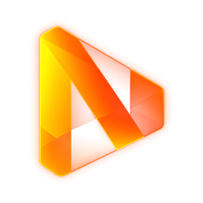
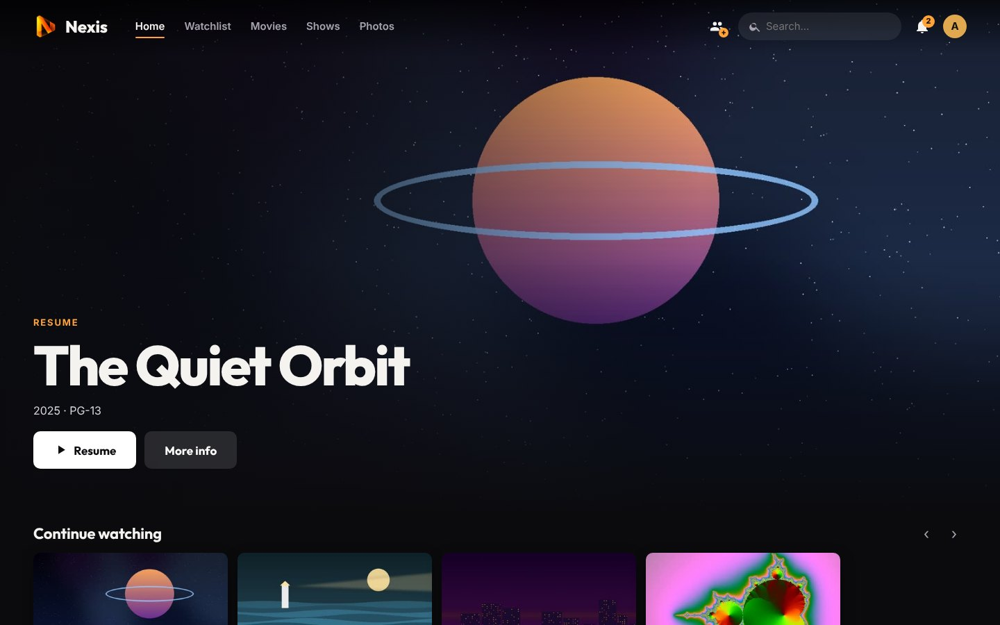
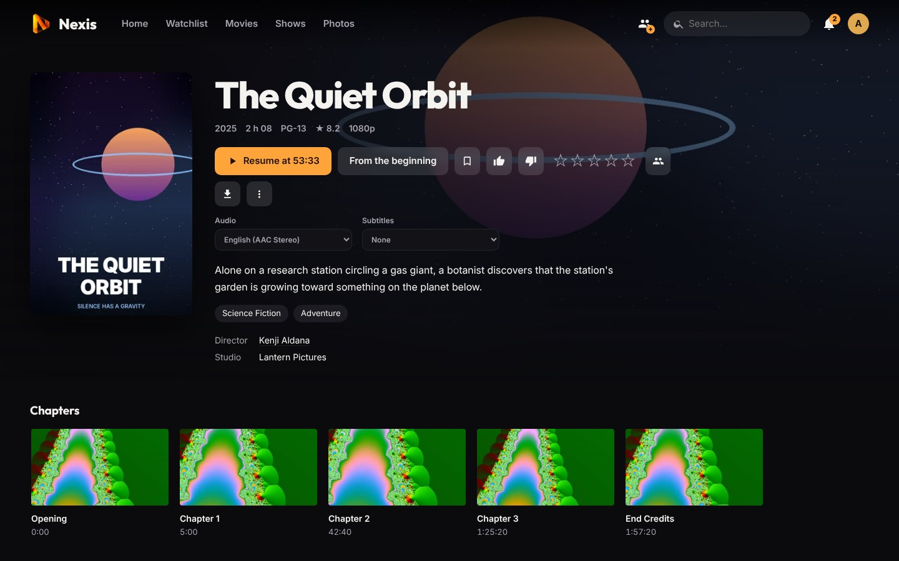
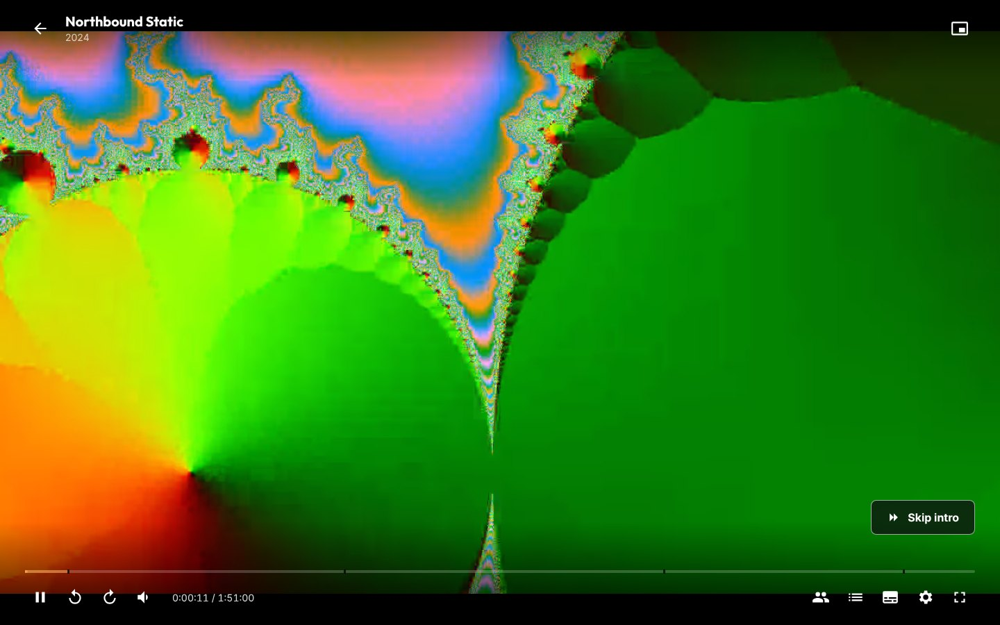
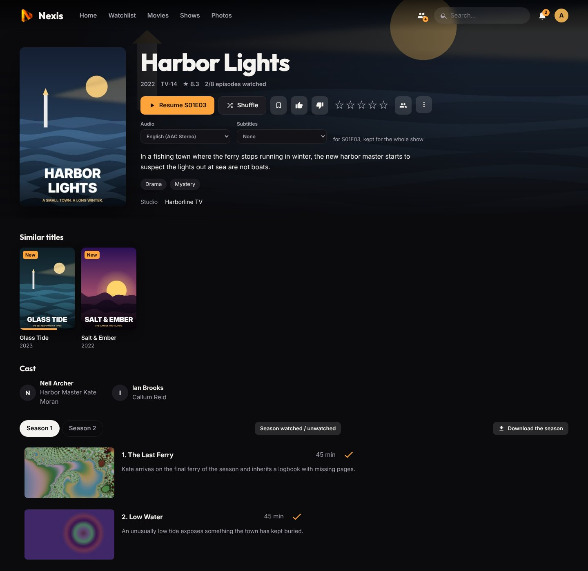
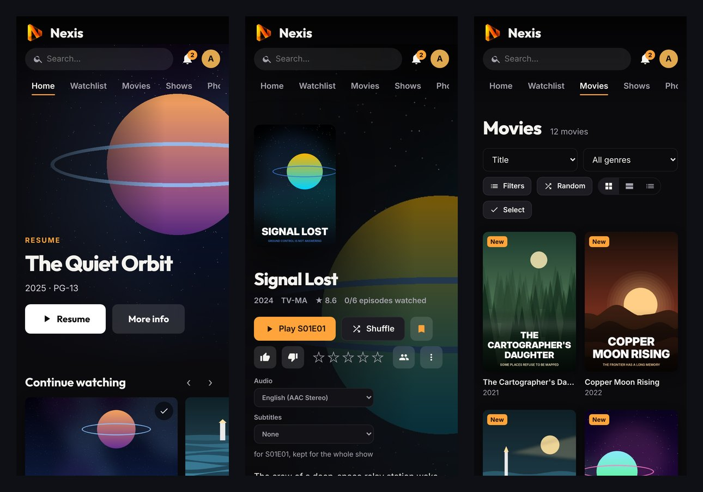
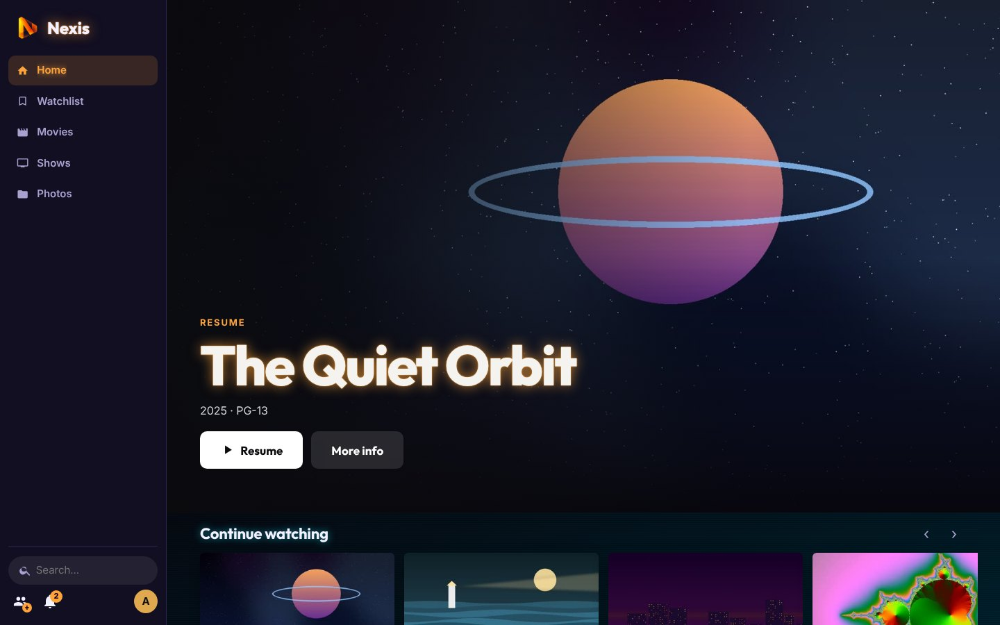
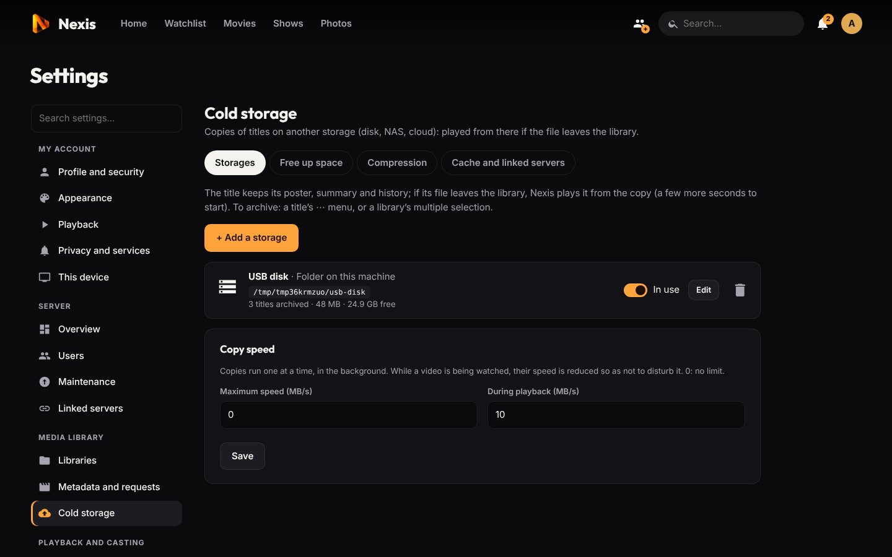

<div align="center">



# Nexis

**Your own streaming service for the movies, shows, anime, photos and audiobooks you already have.**

[](https://github.com/xenix13/Nexis/releases/latest)
[](https://github.com/xenix13/Nexis/actions/workflows/tests.yml)
[](https://github.com/xenix13/Nexis/pkgs/container/nexis)


[Install](docs/installation.md) · [Getting started](docs/getting-started.md) · [Features](#features) · [Documentation](#documentation) · [Releases](https://github.com/xenix13/Nexis/releases)



</div>

## What is Nexis?

Nexis is a **self-hosted media server**. You point it at the folders where your videos live (a NAS, a USB disk, a share on your network), and it turns them into a polished streaming app: posters and summaries, "continue watching", one profile per person, subtitles in your language, and playback on the browser, your TV, your phone or your computer, at home or away.

Everything runs on **your** machine. There is no Nexis account to create, no subscription, no telemetry and no cloud service in the middle: your library, your viewing history and your users stay on your server.

### Why another media server?

Nexis was built for a very ordinary home setup: a small Proxmox box or an old PC, **no graphics card**, the media on a NAS, a few people watching on very different devices. It focuses on what makes that setup pleasant:

- **It avoids converting video whenever it can.** The player tells the server exactly which formats the device can decode, and Nexis picks the cheapest way to play: the original file as is, a light "remux" that only converts the audio track, or a full conversion only when there is no other choice. A small CPU can serve a whole family.
- **It installs in one command and needs nothing else.** The server is written in Python with the standard library only, plus ffmpeg. There is no database server, no Node.js, no runtime to keep up to date. One-line installers exist for Proxmox LXC, Debian/Ubuntu, `.deb` and Docker.
- **It treats your files as read-only.** Nexis never renames, moves or writes into your media folders. Subtitles it downloads, posters it fetches and everything it computes live in its own data folder.
- **It grows with you.** Two homes, two servers? [Link them](docs/linked-servers.md) and they share accounts and libraries. Disks full? Move what nobody watches to [cold storage](docs/cold-storage.md) (a NAS, an S3 bucket, a friend's server) without it disappearing from the app.

## Features

<table>
<tr>
<td width="50%"></td>
<td width="50%"></td>
</tr>
<tr>
<td><b>A real catalogue.</b> Posters, backdrops, summaries, cast, collections and episode titles from TMDB or your own <code>.nfo</code> files. Watchlist, ratings, playlists, extras and trailers.</td>
<td><b>A player that just works.</b> Audio and subtitle choice, chapters, "Skip intro" and "Skip recap", next episode, automatic quality based on the connection, ASS and PGS subtitles rendered in the browser.</td>
</tr>
<tr>
<td></td>
<td></td>
</tr>
<tr>
<td><b>Made for shows and anime.</b> Scene-style names, absolute numbering, specials, season packs. Intros and credits are found from chapter names or by comparing the audio of the episodes.</td>
<td><b>On every screen.</b> Installable web app, native apps for Windows, macOS, Linux, Android and Android TV, offline downloads, push notifications, Chromecast and AirPlay.</td>
</tr>
</table>

| | |
|---|---|
| **Libraries** | Movies, shows, anime, photos and audiobooks. Any number of libraries, each with several folders. New files are picked up within a minute (or instantly from Radarr / Sonarr). `.strm` files supported. |
| **People** | Accounts and profiles ("Who's watching?"), PIN codes, two-factor authentication, age ratings, screen time and bedtime for kids, a simplified kids interface, per-account stream limits. |
| **Playback** | Direct play, remux or transcode chosen per device, hardware transcoding (NVIDIA NVENC, Intel / AMD VAAPI), HDR to SDR tone mapping, 5.1 to stereo downmix with a "night" mode, automatic quality. |
| **Subtitles** | Embedded and external SRT, ASS/SSA, WebVTT, PGS and VobSub. Missing subtitles downloaded from OpenSubtitles (no Bazarr needed) or generated from the audio with Whisper. |
| **Together** | Watch together: synchronized playback for a group, each person on their own device and stream. Use your phone as a remote for another screen. |
| **Discover** | Streaming catalogues and trends (via TMDB) cross-checked with your server, and a **Request** button wired to Seerr. Trakt sync and Letterboxd import / export. |
| **More than video** | Photo library with albums, timeline, map and shared albums; audiobooks with a persistent audio player; live TV from M3U / XMLTV; a DLNA server for TVs and consoles. |
| **Linked servers** | Pair several Nexis servers over their own encrypted link: shared accounts, merged libraries, the best copy of a title chosen automatically, administration of every server from one. |
| **Cold storage** | Archive titles to a disk, NAS, SFTP, WebDAV, S3 or rclone storage, optionally re-encoded to HEVC, and free up the library disk automatically. Titles keep playing from the copy. |
| **Make it yours** | Six interface layouts, themes, a community theme store, accent colours, home rows, wallpapers, per-device settings. Interface in English and French. |
| **Admin** | One settings area with search, scheduled tasks, statistics, alerts pushed to admins, automatic backups (local, linked servers, S3, Google Drive, OneDrive, encrypted), updates from the interface. |

<div align="center">


</div>

## Quick start

Nexis runs on any 64-bit Linux machine, VM or container with **Ubuntu 22.04 / 24.04** or **Debian 12 / 13** (amd64 or arm64). 2 CPU cores and 1 GB of RAM are enough when nothing needs converting.

**Proxmox (creates a ready-to-use LXC container)**, on the Proxmox host:

```bash
bash -c "$(curl -fsSL https://raw.githubusercontent.com/xenix13/Nexis/main/deploy/proxmox-lxc.sh)"
```

**Debian / Ubuntu (VM, LXC or bare metal)**, as root:

```bash
curl -fsSL https://raw.githubusercontent.com/xenix13/Nexis/main/deploy/install.sh | bash
```

**Docker**:

```bash
curl -fsSLO https://raw.githubusercontent.com/xenix13/Nexis/main/docker-compose.yml
mkdir -p data && chown 1000:1000 data
docker compose up -d && docker compose logs nexis   # shows the setup code
```

Then open `http://<server-ip>:8420`, enter the **setup code** printed by the installer and create the administrator account. The [getting started guide](docs/getting-started.md) walks you through adding your first library. A `.deb` package is also attached to every [release](https://github.com/xenix13/Nexis/releases/latest); all the options are in the [installation guide](docs/installation.md).

## Apps

| Device | App | How to install |
|---|---|---|
| Any browser | Web app | Open the server address; **Install app** from the profile menu (HTTPS required) |
| Windows 10 / 11 | `Nexis-Setup.exe` | Profile menu → **Install app**, or the **Apps** page of your server |
| macOS 12+ (Intel and Apple silicon) | `Nexis.dmg` | Same |
| Linux | `Nexis.AppImage` or `.deb` | Same |
| Android phones and tablets | `nexis-android.apk` | Same |
| Android TV, Google TV, Shield | `nexis-tv.apk` | With the *Downloader* app, type `<your-server>/tv` |
| iPhone and iPad | Web app | Safari → Share → **Add to Home Screen** |

Apps are served by your own server and keep themselves up to date. Details in [Apps and offline viewing](docs/apps.md).

## Documentation

| Guide | What's inside |
|---|---|
| [Installation](docs/installation.md) | Proxmox LXC, install script, `.deb`, Docker, NAS shares, graphics cards, HTTPS, updates |
| [Getting started](docs/getting-started.md) | First launch, metadata, libraries, file naming, users and profiles |
| [Playback, transcoding and subtitles](docs/playback.md) | How Nexis chooses how to play, quality, HDR, audio, subtitles, intros, casting, watch together |
| [Apps and offline viewing](docs/apps.md) | Web app, desktop and Android apps, Android TV, downloads, notifications, remote control |
| [Linked servers](docs/linked-servers.md) | Pairing servers, shared accounts and libraries, network setup |
| [Cold storage](docs/cold-storage.md) | Archiving, compression, freeing up space with Radarr / Sonarr |
| [Photos, audiobooks, live TV and DLNA](docs/more-libraries.md) | The libraries that are not movies or shows |
| [Personalization and discovery](docs/personalization.md) | Layouts, themes and the theme store, home screen, lists, Discover, Seerr, Trakt |
| [Administration](docs/administration.md) | Settings, scheduled tasks, statistics, alerts, backups, 2FA, security |
| [Troubleshooting](docs/troubleshooting.md) | Common problems and where to look |
| [Development](docs/development.md) | Running from source, tests, code layout, translations, contributing |

## Project status

Nexis **4.0** is the first stable release. Releases follow [semantic versioning](https://semver.org): servers update themselves from the interface, and a *Test* update channel lets you try new features before they reach *Stable*. See the [changelog](https://github.com/xenix13/Nexis/releases).

## Contributing

Bug reports, ideas, translations and themes are very welcome. Please read [CONTRIBUTING.md](CONTRIBUTING.md) first; security issues go through [SECURITY.md](SECURITY.md), not public issues.

## Credits

Nexis builds on [ffmpeg](https://ffmpeg.org), [hls.js](https://github.com/video-dev/hls.js), [JASSUB](https://github.com/ThaUnknown/jassub) / libass, [libpgs](https://github.com/Arcus92/libpgs-js), the Inter, Outfit and Liberation Sans fonts, AndroidX Media3 and Electron. Their licences are in [`static/vendor`](static/vendor) and [`static/fonts`](static/fonts).

This product uses the TMDB API but is not endorsed or certified by [TMDB](https://www.themoviedb.org). Map tiles © [OpenStreetMap](https://www.openstreetmap.org/copyright) contributors.

The demo titles in the screenshots are fictional; their posters and videos were generated for this documentation ([`tools/screenshots`](tools/screenshots)).

## License

See [LICENSE](LICENSE).
