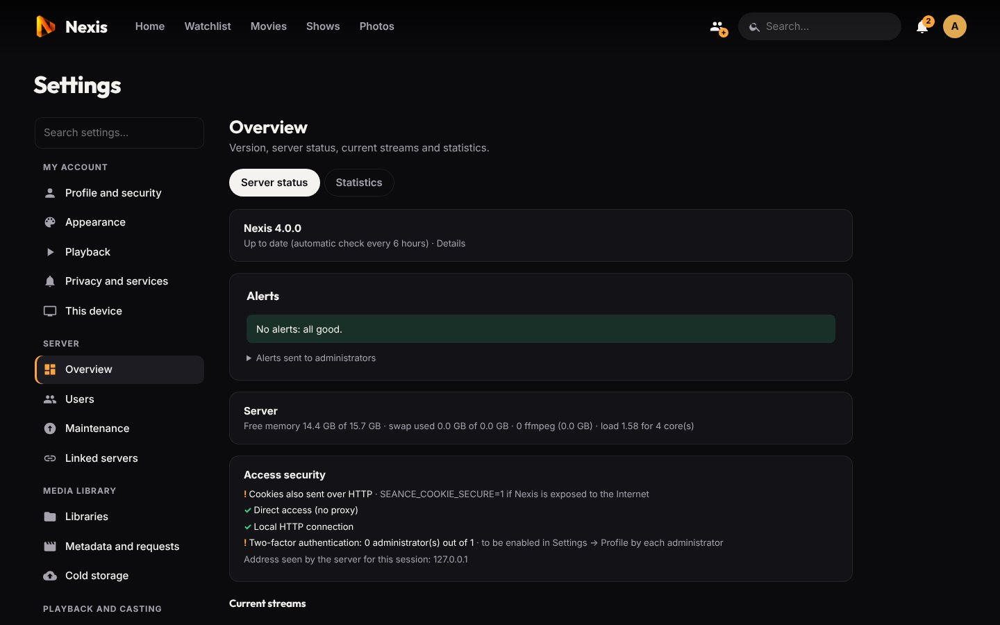
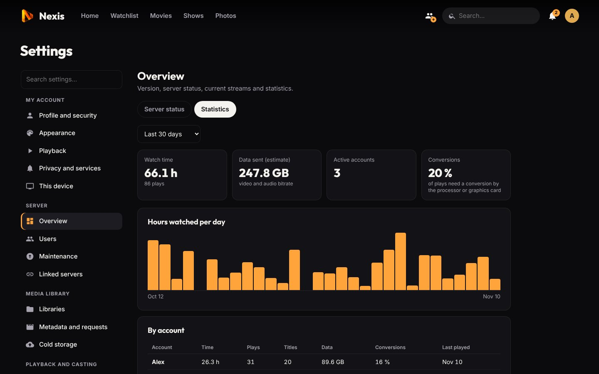
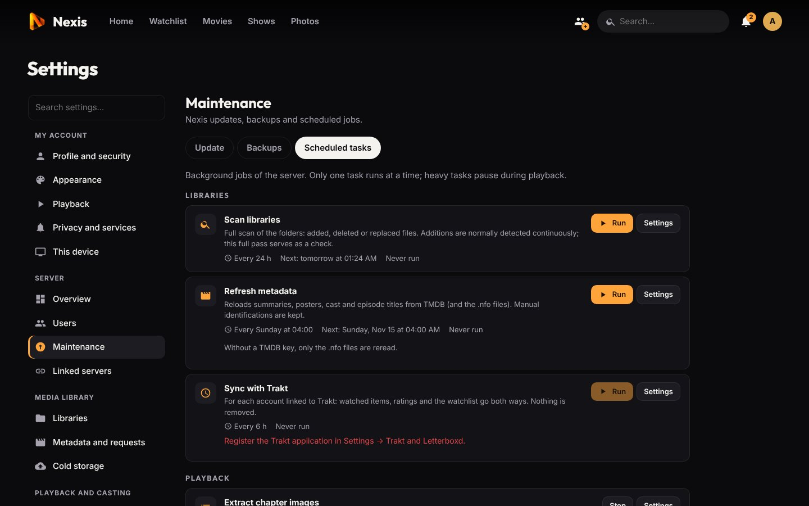

# Administration

[← Back to the README](../README.md) · Previous: [Personalization](personalization.md)

**Contents:** [Overview](#overview) · [Statistics](#statistics) · [Alerts](#alerts) · [Scheduled tasks](#scheduled-tasks) · [Backups](#backups-and-restore) · [Two-factor authentication](#two-factor-authentication) · [Security](#security) · [Command line](#command-line)

## Overview

*Settings → Overview → Server status* shows the version and update state, alerts, memory, swap and load, the security of the access (cookies, proxy, HTTPS, how many admins use 2FA) and every **current stream** with its mode (direct, remux, transcode), the reason, the **conversion speed** (below ×1 the CPU cannot keep up) and the last ffmpeg messages.



## Statistics

*Settings → Overview → Statistics*, over 7 days, 30 days, 3 or 12 months:

- watch time, number of plays, active accounts, share of converted plays, data sent (estimated from the video and audio bitrates);
- hours watched per day;
- per account: time, plays, titles, data, conversions, last play;
- the most watched titles (an episode counts for its show);
- the **never watched titles**: movies and shows nobody started, added more than 90 days ago, biggest first, with the space they take (a good list for [cold storage](cold-storage.md)).

Every play longer than 30 seconds is logged when it ends. In private mode the duration counts but the title is not kept.



## Alerts

*Settings → Overview → Server status → Alerts*: every 5 minutes Nexis checks that everything is fine and warns administrators with a **push notification** (on the devices where they are enabled):

- **disk almost full** for Nexis's data or the backups (less than 10 GB free by default, or less than 3 %);
- **library folder unreachable**, or empty while it used to have titles (unmounted share);
- **linked server unreachable** for more than 15 minutes;
- **scheduled task failed** (scan, backup, subtitles…).

An alert is sent once, repeated once a day while the problem lasts, and clears itself once solved. Each kind can be turned off; **Send a test alert** checks delivery.

## Scheduled tasks

*Settings → Maintenance → Scheduled tasks* lists the background jobs with their last and next run. Each one can be started, stopped and scheduled (**off**, **every N hours**, **every day** or **every week** at a fixed time) with its own options. Only one task runs at a time, and those that read files on a network share **pause during playback**.

| Task | Default | Options |
|---|---|---|
| Scan libraries | every 24 h | libraries |
| Sync with Trakt | every 6 h (Trakt app registered) | |
| Refresh metadata | Sunday 4:00 | incomplete / not refreshed for N days / all; libraries |
| Extract chapter images | every night and after each import | pause during playback, libraries |
| Detect intros and credits | every night and after each import | analysed zones, min. and max. durations, end credits |
| Prepare subtitles and previews | every night | |
| Download missing subtitles | every night at 6:10 and after each import (OpenSubtitles set up) | libraries |
| Generate missing subtitles (Whisper) | off | titles per run, pause during playback, libraries |
| Free up space | every day at 5:10 ([cold storage](cold-storage.md#free-up-space-automatically)) | |
| Refresh channels and TV guide | every 12 h | channel check |
| Clean caches | every night | age of kept images |
| Back up the server | every night at 4:30 | number of automatic backups kept |



## Backups and restore

*Settings → Maintenance → Backups*.

- **Content:** the archive (`.tar.gz`) holds the database (accounts and hashed passwords, 2FA, history, ratings, playlists, settings, libraries and metadata), the linked-servers identity, the notification keys, profile pictures and downloaded subtitles. Videos and photos are not included; caches rebuild themselves.
- **Names:** `nexis-<server>_<date>-<time>-auto.tar.gz` (e.g. `nexis-living-room_20261107-043000-auto.tar.gz`), so that you can tell servers apart when they keep each other's backups. `-auto`: automatic; no suffix: made by hand.
- **Automatic:** every night at 4:30 by default (or weekly), keeping the last 7 of each server. Backups made by hand are never deleted.
- **Folder:** `data/backups` by default; another disk or a NAS is better (Docker: mount it, e.g. `- /mnt/nas/nexis:/backups`, and choose it as *Backup folder*). Archives are readable by Nexis only (mode 600).
- **Copied between linked servers:** each backup is also sent to the [linked servers](linked-servers.md), which keep each server's backups apart. If a server dies, its latest backup is on another one. Each server can turn sending or receiving off.
- **External storages:** each backup can also go to one or more storages, each keeping its own number of copies: **S3** (AWS, Backblaze B2, Wasabi, Scaleway, OVH, MinIO…), **Google Drive** (an OAuth app created once on console.cloud.google.com, type "TVs and Limited Input devices", Drive API enabled; Nexis only sees the files it created) or **OneDrive** (an app registered once on portal.azure.com with public client flows allowed; Nexis only writes to its app folder). Step-by-step instructions are shown in the add window.
- **Encryption:** with a passphrase (*Encryption of off-server copies*), copies sent to S3, Google Drive and OneDrive are encrypted (AES-256, `.tar.gz.enc`): the provider cannot read them. Keep the passphrase somewhere else: without it those copies cannot be restored.
- **Restore:** *Restore* on a backup of the list (including a linked server's copy), *Restore from a file…* (from your device, `.tar.gz` or `.enc`), *Restore from a server file…* (a path, e.g. on a mounted disk), or *See backups* of an external storage then *Restore*. Nexis checks the archive, restarts and puts it in place before opening the database; the previous state is kept in `data/before-restore-<date>`. A backup from a newer Nexis is refused; an older one is upgraded at start-up.
- **Replace a dead server:** install Nexis on the new machine, create the admin account, then *Restore from a file…* with a backup downloaded from a linked server or an external storage. The server takes over the old one's identity, so linked servers recognize it. From the console, with Nexis stopped: `python3 -m seance --data /var/lib/seance restore archive.tar.gz` (add `--passphrase "…"` for an `.enc` archive).

## Two-factor authentication

Everyone who signs in with a password can turn it on in *Settings → Profile and security*: a 6-digit code from an authenticator app (Google Authenticator, Microsoft Authenticator, Aegis, 2FAS, Bitwarden…) is then asked at every sign-in. Managed profiles (no password) are not concerned.

- **Setup:** password, QR code to scan (or key to type), then a first code to confirm. The account's other devices are signed out.
- **Recovery codes:** 10 one-time codes shown once at setup (copy, download or print). They replace the phone if it is lost; new ones can be generated from the same page.
- **Switching profile** to a protected account also asks for its code.
- **Lost phone:** an administrator resets it from the user's page (*Settings → Users → Edit → Reset*). The user signs in with their password and can turn it on again.
- Codes follow TOTP (RFC 6238); a code already used is refused, and failed attempts are rate-limited like passwords. The *Overview* shows how many administrators use it.

## Security

- **Mount your media read-only.** Nexis only needs to read it, and *Settings → Libraries* flags a folder it could write to.
- **Expose Nexis to the Internet only behind an HTTPS reverse proxy**, with `SEANCE_COOKIE_SECURE=1` and `SEANCE_TRUST_PROXY=1` ([details](installation.md#https-and-remote-access)). Turn on 2FA for administrators.
- Nexis runs as an unprivileged `seance` user, in a systemd sandbox when the system allows it. Mounting shares goes through `seance-mountd`, a separate root helper that can only mount read-only under `/mnt/seance/` and only accepts requests from the `seance` user.
- Passwords are hashed; secrets of external services (SMB, S3, OpenSubtitles…) are never sent back to the interface. Third-party scripts and the subtitle renderers shipped in the repository are checked against their SHA-256 at install time.
- Only add IPTV playlists from providers you trust.
- The audits and accepted risks are documented (in French) in [`AUDIT-SECURITE.md`](AUDIT-SECURITE.md) and [`AUDIT-SECURITE-2026-10.md`](AUDIT-SECURITE-2026-10.md). To report a vulnerability, see [SECURITY.md](../SECURITY.md).

## Command line

The `nexis` command is available on script and `.deb` installs (as root):

```bash
nexis list-users              # accounts and their 2FA state
nexis reset-2fa <username>    # turn 2FA off for an account (lost phone, admin locked out)
```

With Docker: `docker compose exec nexis python3 -m seance reset-2fa <username>`.

Reset a password:

```bash
cd /opt/seance && sudo -u seance python3 -c "
from seance.db import DB; from seance.auth import hash_password
db = DB('/var/lib/seance/seance.db')
db.run('UPDATE users SET password_hash=? WHERE username=?', (hash_password('NewPassword'), 'admin'))
db.run('DELETE FROM sessions')"
```

---

Next: [Troubleshooting →](troubleshooting.md)
