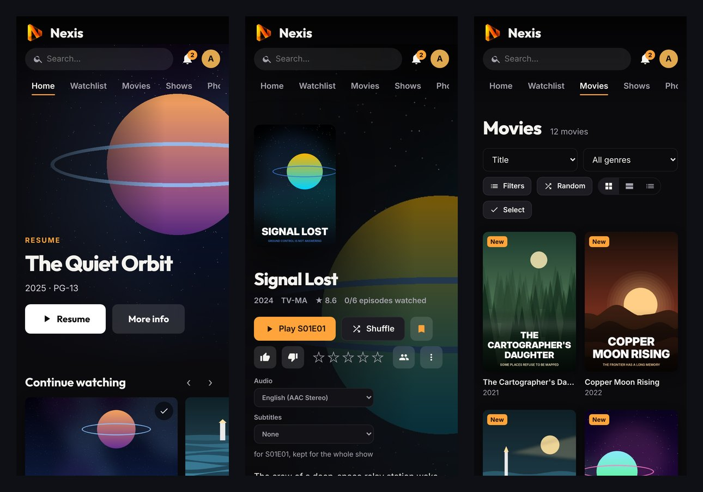

# Apps and offline viewing

[← Back to the README](../README.md) · Previous: [Playback](playback.md)

Nexis plays in any modern browser, and installs as an app on every common device. All apps are **served by your own server** (not by an app store) and display your server's interface, so they follow each server update without reinstalling.

**Contents:** [Which app for which device](#which-app-for-which-device) · [Web app](#web-app) · [Desktop and Android apps](#desktop-and-android-apps) · [Android TV](#android-tv) · [Offline downloads](#offline-downloads) · [Push notifications](#push-notifications) · [Updates](#updates)

## Which app for which device

Profile menu → **Install the app** shows the best choice for the device you are on (native app, recommended, or web app), then every other platform with its logo, file, version and installation steps. The same list is on the public **Apps** page (linked from the sign-in page).

| Platform | File | First launch |
|---|---|---|
| Windows 10 / 11 | `Nexis-Setup.exe` | "Windows protected your PC": *More info* → *Run anyway* (the app is not signed with a paid certificate) |
| macOS 12+ (Intel, Apple silicon) | `Nexis.dmg` | *System Settings → Privacy & Security → Open Anyway* (no Apple developer account) |
| Linux | `Nexis.AppImage` or `nexis-desktop.deb` | Make the AppImage executable |
| Android 8+ (phone, tablet) | `nexis-android.apk` | Allow installing from the browser, once |
| Android TV, Google TV | `nexis-tv.apk` | With the *Downloader* app, address `<server>/tv` |
| iPhone, iPad | Web app | Apple does not allow installing apps outside the App Store |

## Web app

Nexis installs as a Progressive Web App: its own icon and window, no address bar, and shortcuts (Watch together, Live TV, Watchlist). **HTTPS is required** (see [HTTPS and remote access](installation.md#https-and-remote-access)).

- **Chrome or Edge (Windows, macOS, Linux, Android):** profile menu → **Install the app**, or the install icon of the address bar.
- **iPhone and iPad (Safari; Firefox or Chrome since iOS 16.4):** **Share** → **Add to Home Screen**. Installing is recommended: Safari erases the data of a site that is only visited after a few weeks.
- **Firefox:** it does not let sites trigger installation, so **Install the app** shows the steps for the device (Android: **⋮** → *Add to Home screen*; Windows, Firefox 143+: *Add to taskbar* icon). On macOS and Linux, use the desktop app.

The interface code is loaded from addresses unique to each version, so no cache (browser or proxy) can ever serve an old version after an update. If the server cannot be reached, the app opens on the device's downloads.

## Desktop and Android apps

Each app asks for the server address on first launch (`https://media.example.com` or `192.168.1.20:8420`), checks that it really is Nexis, then shows its interface. The engine is the app's own (Chromium on computers, the system WebView on Android), so playback and formats are the same whatever your usual browser is.

What they add over a browser tab:

- **On computers:** a server on `http://` on your home network is treated as secure, so offline downloads work without HTTPS; no per-site storage limit; sleep is delayed while downloading and progress shows on the taskbar icon.
- **On Android:** true full-screen video, file uploads (profile picture, backup, theme), exported files saved to Downloads, and [native notifications](#push-notifications).
- **Background downloads:** a download keeps going when the app is closed or minimized. On Android a "Nexis is downloading…" notification shows the progress while the queue is not empty (Android requires it to let a closed app work) and the phone stays awake for the transfer, screen off included. Swiping the app away from the recent apps stops the download; it resumes when the app opens again.
- **Unstable networks** (airport or train Wi-Fi…): at the slightest drop Nexis checks that the server answers and resumes where it left off ("Unstable connection: retrying…"). With no network for more than 30 s the download waits ("Waiting for the network") and restarts by itself: every 10 s to 1 min, and as soon as the connection comes back or the app returns to the foreground.

*Settings → This device → This app*: version, **Check for updates**, **Change server…**.

## Android TV

A native app for Android TV, Google TV and boxes (Shield, Chromecast with Google TV), built for the remote:

- **Navigation:** Home (Continue watching, a row per library, Watchlist), one entry per library, Search, Live TV and Settings. Posters and text are larger for viewing from the couch; left / right stay in a row, up / down move between rows and remember where you were.
- **Native player (ExoPlayer):** MKV, HEVC and 10-bit play directly when the TV can decode them, and multichannel audio (Dolby Digital, Dolby Digital+, DTS, TrueHD) is passed through to your amplifier when the HDMI output accepts it. The server only converts what the device cannot play.
- **While a video loads**, the app says what is happening (direct play, stream prepared by the server, conversion and its reason) and for how long. A direct play that does not start within 20 s switches by itself to a server-prepared stream.
- **Remote:** OK to play / pause, left / right to seek (faster when held), up / down for the controls (audio and subtitles, next episode). Live TV: up / down or CH+ / CH- to zap.
- Playback settings (languages, quality, next episode, credits) follow the account: change them from your phone or computer.

**Install with Downloader:**

1. Install **Downloader** (by AFTVnews) from the Play Store.
2. Allow it in *Settings → Apps → Special app access → Install unknown apps*.
3. In Downloader, type your server address followed by `/tv` (for example `media.example.com/tv`): it redirects to the latest APK.
4. Install, then open Nexis from the app list.

The APK `nexis-tv-<version>.apk` is also attached to every [release](https://github.com/xenix13/Nexis/releases/latest) (*Send Files to TV*, USB stick or `adb install`).

> **Signing:** updating an Android app over an older one requires both to be signed with the same key. If you build Nexis yourself, provide the GitHub secrets `NEXIS_KEYSTORE` (base64 PKCS#12 keystore) and `NEXIS_KEYSTORE_PASSWORD`; without them the CI signs with a development key and each update needs an uninstall.

## Offline downloads

Movies, episodes or whole seasons can be downloaded to watch without a connection (in the apps, and in browsers over HTTPS).

- **Download:** the ⤓ button on a movie or episode, or **Download the season** (unwatched episodes first). For each quality the window shows the size and whether a conversion is needed. **Automatic** (default) keeps the file as is when the device can play it: about 2 s of server CPU per minute of video, versus 30 s for a conversion. 720p and 480p save space at the cost of a conversion. Language and subtitles are chosen in the same window.
- **Follow-up:** profile menu → **Downloads** (preparing, transferring, space used by movies and shows, sorting). Transfers go in 16 MB chunks, four at a time, and resume after a drop. Except in Safari, the device fetches the file **while** the server prepares it, so a download takes about as long as the preparation alone. The next two downloads are prepared ahead.
- **Clean up fast:** *Select*, then tick, or pick *All*, *Watched*, *Older than 30 days*, *Failed* or a whole show, and *Delete* (the freed space is shown).
- **Smart downloads** (device setting on the Downloads page): finishing a downloaded episode downloads the next one in the same languages and quality (on by default); the watched episode can also be deleted (off by default). Watched offline: done when the connection returns.
- **Offline playback** uses the usual player (subtitles, "Skip intro", chapters, next downloaded episode). The position is sent back to the server when the network returns, without overwriting a more recent viewing made elsewhere.
- **Server side:** Nexis prepares an MP4 (H.264 / AAC): a compatible MP4 is sent as is, an H.264 MKV is copied losslessly, the rest is converted (with the graphics card if configured). *Settings → Casting and offline → Offline downloads* sets the preparation speed: *Normal* (full speed when nobody watches, low priority during playback), *Discreet* (one at a time, paused during any playback) or *Fast*. Prepared copies are deleted once fetched, or after 48 h.

**Storage space** is decided by the browser, not the device: Firefox limits each site to 10 GB until persistent storage is allowed (**Allow more space** on the Downloads page); Chrome, Edge and Safari allow about 60 % of the storage. The desktop and Android apps store downloads in their own data, which the system does not erase, and can use all the device's free space.

## Push notifications

*Settings → This device → Notifications*: a new episode of a show you follow, or a requested title that arrives, notifies the device even when Nexis is closed. Admins also receive [server alerts](administration.md#alerts).

- **Browsers** need HTTPS; on iPhone and iPad, Nexis must be installed on the home screen (iOS 16.4+). The server only contacts the browsers' push services (Google, Mozilla, Apple, Microsoft) with **empty messages**: the device then asks your server for the content.
- **Android app** (1.1+): it shows the notifications itself. On first use Android asks for permission; the device gets its own revocable token and checks your server for new messages about every 15 minutes, even when the app is closed and after a reboot. No third-party service (no Google account or developer key) is involved; in exchange a notification can arrive a few minutes late, more in deep sleep. A device silent for 60 days is unregistered.
- **Quiet hours** (e.g. 10 pm to 8 am) keep notifications in the bell without ringing; shows can be muted one by one.

## Updates

Apps check your server every 6 hours. Windows and Linux (AppImage) install the new version on restart; Android downloads the APK and offers to install it; macOS and the `.deb` offer to download the new version.

Under the hood, the CI builds the apps and attaches them to each GitHub release. Your server reads that release and keeps a copy of the files (in `<data>/apps`): devices download them **from your server**, never from GitHub (the very first download of a file is redirected to GitHub while the copy is made). Sources: [`apps/desktop`](../apps/desktop) (Electron) and [`android`](../android).

---

Next: [Linked servers →](linked-servers.md)
