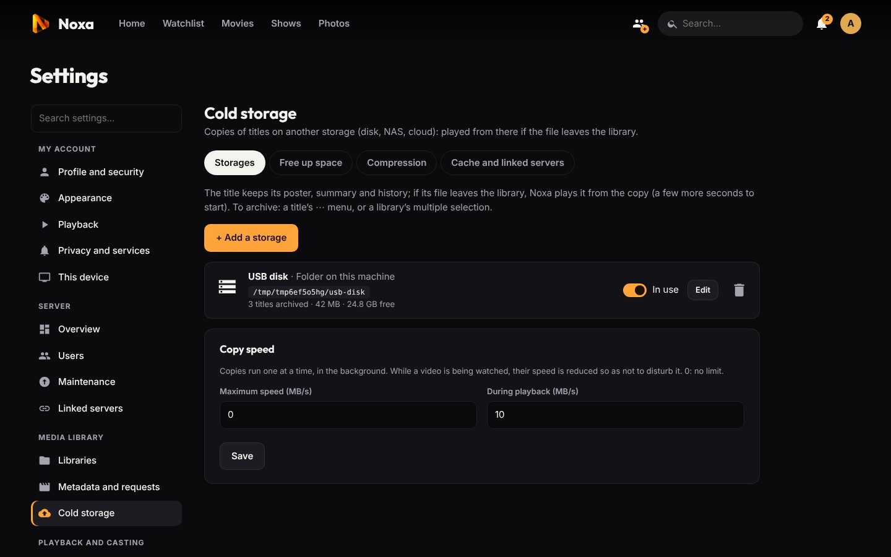

# Cold storage

[← Back to the README](../README.md) · Previous: [Linked servers](linked-servers.md)

Disks fill up, and most of a library is not watched very often. **Cold storage** keeps a copy of movies and episodes on another storage (a USB disk, a NAS, a Hetzner Storage Box, an S3 bucket, a linked server…) so that you can free space on the library disks **without the titles disappearing from Noxa**.

An archived title keeps its poster, summary, history and downloaded subtitles, and shows up everywhere as before. When its file is no longer in the library, Noxa plays it **from the copy**, with a few more seconds at start-up.

**Contents:** [Storages](#storages) · [Archiving](#archiving-titles) · [Playing from cold storage](#playing-from-cold-storage) · [Compression](#compressing-archives) · [Free up space automatically](#free-up-space-automatically) · [Radarr and Sonarr](#removing-the-original-files)

## Storages

*Settings → Cold storage → Storages → **+ Add a storage***. You can have several at once, and keep a title on several of them.

| Type | For | Playback |
|---|---|---|
| **Folder on this machine** | USB disk, NAS already mounted by the system, Docker volume | direct, like a library file |
| **SMB share (NAS)** | NAS, Hetzner Storage Box (SMB): mounted read-write by Noxa (script or package install; with Docker, mount it on the host and use "Folder") | direct |
| **SFTP** | Hetzner Storage Box, NAS, any SSH server | in chunks, relayed by Noxa |
| **WebDAV** | Nextcloud, Synology, Hetzner Storage Box | in chunks |
| **S3 and compatible** | Backblaze B2, Wasabi, Scaleway, OVH, AWS, MinIO (multipart upload, files of tens of GB) | in chunks |
| **rclone** | Any other service already set up with `rclone config` (pCloud, Mega, Google Drive…), if rclone is installed | in chunks |
| **Linked server** | A [linked server](linked-servers.md) whose admin reserved space for you | in chunks, over the encrypted link |

When a title has several copies, a folder (disk, mounted share) is preferred over an online storage.

**SFTP:** on the first test, Noxa shows the server's key fingerprint for you to confirm; afterwards it refuses any server presenting another key. Passwords are never sent back to the interface nor passed on a command line.

**Linked server as storage:** its administrator reserves space in *Cold storage → Cache and linked servers → Archives of linked servers*. Files travel over the linked-servers encrypted channel and are stored in its data folder, without appearing in its libraries.

## Archiving titles

- **By hand:** on a title page, **⋯ → Archive to a cold storage…** (a show or a season: all its episodes), or with the multiple selection of a library.
- **Automatically:** see [Free up space automatically](#free-up-space-automatically).

Copies run in the background, one at a time; their speed is reduced while someone watches (10 MB/s by default, adjustable). Subtitles next to the file are copied with it. On the storage, files keep the library's folder layout (`Movies/Title (2020)/Title.mkv`): **they remain usable without Noxa**.

**Verification:** a copy only counts once verified (size, plus chunks read back at the beginning, the end and at random). A failure stays visible with its reason and a **Retry** button.

**Nothing is deleted from your library** by archiving: libraries stay read-only. If a file disappears from the library (deleted by hand or by Radarr / Sonarr), the scan keeps the title because it has a verified copy.

To check that everything works: **⋯ → Try playing from the cold copy** plays the copy even though the file is still there; **⋯ → Copies on cold storage…** lists the copies and lets you delete one (not the last copy of a title that is no longer in the library).

## Playing from cold storage

- From a folder or mounted share, the copy plays like a library file.
- From an online storage (SFTP, WebDAV, S3, rclone, linked server), Noxa reads the copy in chunks through a local relay, so seeking works and the player does not know the difference.
- **Local cache:** a title played from an online storage is brought back onto this server, with the next 2 episodes (adjustable), so that the following plays start immediately. 20 GB are reserved by default, always keeping 10 GB free on the disk; the titles cached longest ago without being played leave first. The cold copy stays where it is.

## Compressing archives

Optional, **graphics card recommended**. Before being copied, the video is re-encoded to HEVC (NVENC or VAAPI if a graphics card is configured, otherwise libx265 on the CPU), usually saving **30 to 60 %** on the storage. Audio, subtitles, chapters and fonts are copied as they are.

- Quality (very good, balanced, small size) and maximum resolution are adjustable.
- Videos already in HEVC, AV1 or VP9, and HDR videos, are copied unchanged; the original is kept if the gain is below 10 %.
- On the CPU it is very slow on a small machine (one to several hours per movie), and it pauses while someone watches a converted stream.
- **Compress existing archives** re-reads, compresses then replaces the copies already made.
- The compressed copy has its own technical description, so the player chooses between direct play and conversion based on it.
- Library files are **never modified**; the work happens in `<data>/cold-work` (free space needed: the file size + 2 GB).

## Free up space automatically

*Cold storage → Free up space*: movies and shows **nobody has watched for 30 days** (adjustable; a title never watched counts from when it was added) are copied to cold storage, then their file leaves the library after a **7-day grace period** (adjustable). A title watched during that period is kept. The *Free up space* task runs every day at 5:10.

- **To approve** (default): the list of titles arrives on the page with a notification to administrators; **Confirm**, **Keep on disk** or **Not this time**, one by one or all at once. **Automatic**: archived and freed without asking.
- **Kept:** titles in someone's Watchlist, rated 4 or 5 stars or in progress (adjustable), and those marked **⋯ → Always keep on disk**. Option: only act when the library's free space drops below a threshold.
- The title stays in Noxa (poster, summary, history, ratings) and plays from the cold copy; it is not proposed again. If the file comes back to the library (downloaded again), Noxa plays it from the disk again.

## Removing the original files

Your libraries are read-only for Noxa, so something has to delete the original file once the cold copy is verified. Per library, choose one of:

- **Radarr** (movies) or **Sonarr** (shows): their address and API key (*Settings → General → API Key* in Radarr / Sonarr). The title is first marked **unmonitored** (otherwise they would download it again), and nothing is deleted if the file they know is not the same one (name, size).
- **Noxa**, if the library is mounted read-write for it.
- **By hand**, from the list of files Noxa gives you.

Before the file goes, embedded subtitles are extracted and those next to it (`.srt`, `.ass`…) are copied into Noxa's data, so they remain available.

---

Next: [Photos, audiobooks, live TV and DLNA →](more-libraries.md)
