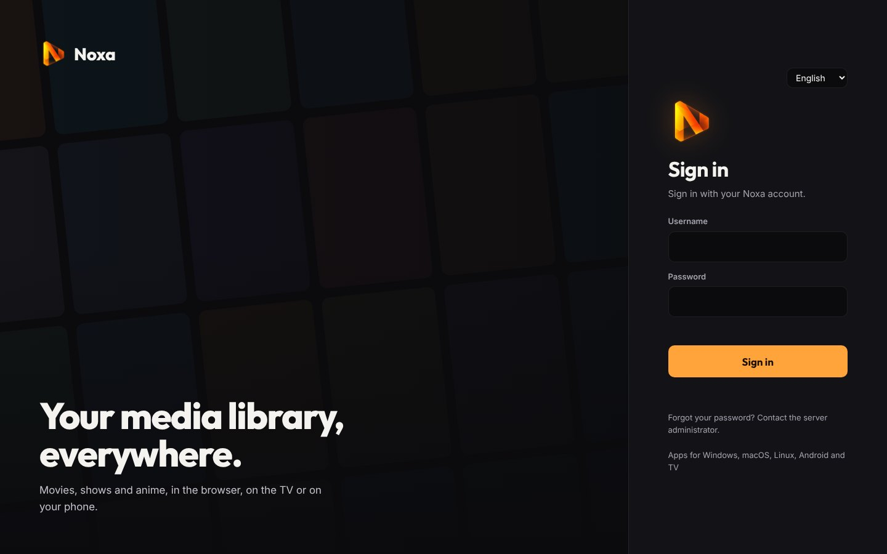
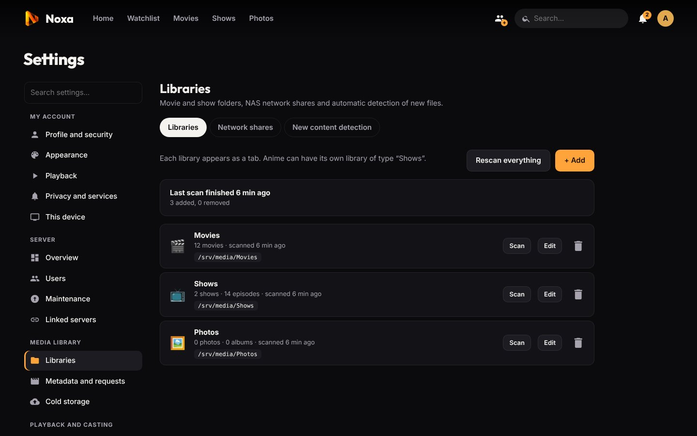
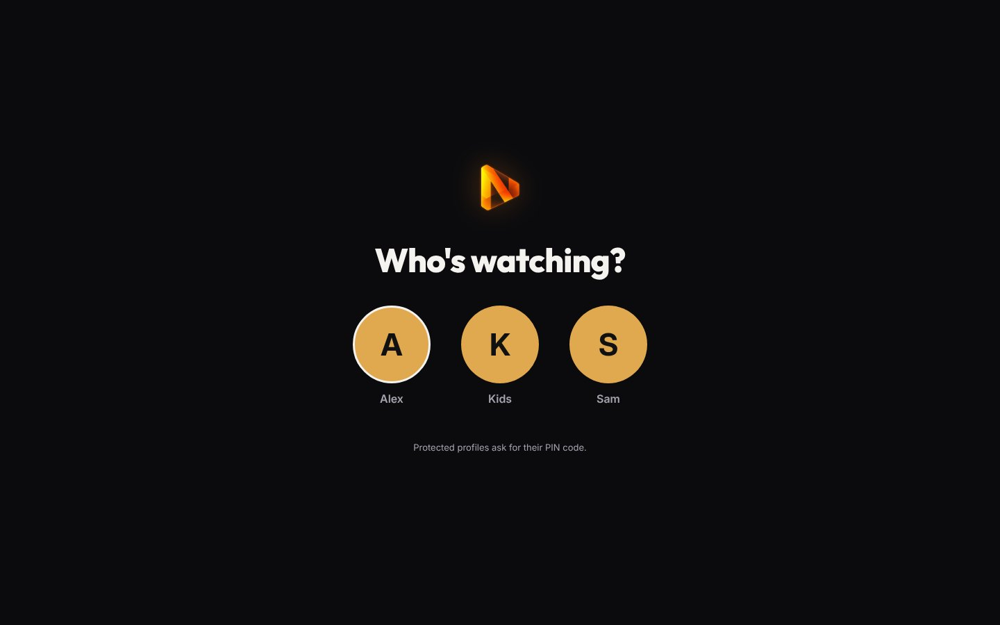
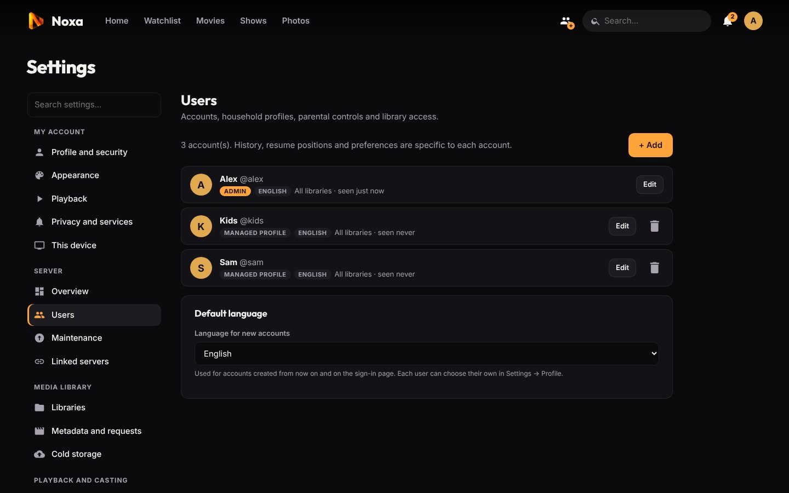

# Getting started

[← Back to the README](../README.md) · Previous: [Installation](installation.md)

This guide takes you from a fresh install to a family-ready server in about ten minutes.

**Contents:** [First launch](#1-first-launch) · [Metadata](#2-metadata-tmdb) · [Libraries](#3-add-your-libraries) · [File naming](#naming-your-files) · [New content](#how-new-files-are-detected) · [Users and profiles](#4-users-and-profiles) · [Parental controls](#parental-controls) · [The settings area](#finding-your-way-in-the-settings)

## 1. First launch

Open `http://<server-ip>:8420` in a browser. The first page asks for the **setup code** printed by the installer, then creates the administrator account and picks the default language of the server.

Lost the code? It stays readable until the first account exists:

```bash
cat /var/lib/seance/setup-code.txt     # Docker: docker compose logs noxa
```



## 2. Metadata (TMDB)

Noxa gets posters, backdrops, summaries, cast, collections and episode titles from **The Movie Database**. A free key takes two minutes:

1. Create an account on [themoviedb.org](https://www.themoviedb.org/), then *Settings → API* and request a key (v3 API key or v4 read token).
2. In Noxa: *Settings → Metadata and requests → Metadata*, paste the key and save.

The metadata language follows the server setting on the same page, with English as the fallback.

**Without a key**, Noxa still works: it uses the file names, Kodi-style `.nfo` files (`movie.nfo`, `tvshow.nfo`, `<episode>.nfo`) and local images (`poster.jpg`, `fanart.jpg`, `<name>-poster.jpg`…). Local `.nfo` files and images always take priority over TMDB, so a curated library keeps its look. (The demo library in these screenshots uses only `.nfo` files.)

> Linked servers can share one TMDB key: a server without a key uses the key of a server it is [linked](linked-servers.md) to.

## 3. Add your libraries

*Settings → Libraries → **+ Add***: give the library a name, a type and one or more folders. **Browse…** shows the folders the server can see.

| Type | For | Examples |
|---|---|---|
| **Movies** | Films, one per folder or loose files | `/mnt/movies` |
| **Shows** | Series and anime, one folder per show | `/mnt/shows`, `/mnt/anime` |
| **Photos** | Photo and phone video folders | `/mnt/photos` |
| **Audiobooks** | One folder (or one `.m4b`) per book | `/mnt/audiobooks` |

Anime usually gets its own *Shows* library ("Anime") so that it has its own tab and its own language preferences.

The first scan probes every file with ffprobe; it takes a few minutes for a few thousand files on a network share. Files Noxa could not recognize are listed so that you can rename them. A wrongly matched title is fixed from its page with **⋯ → Identify…**; your choice is kept on later scans.



### Naming your files

Noxa understands the common layouts and most "scene" names:

```
Movies/Inception (2010)/Inception (2010).mkv
Movies/Inception.2010.1080p.BluRay.x264-GROUP.mkv
Shows/Breaking Bad/Season 01/Breaking Bad - S01E01.mkv
Shows/Breaking Bad/Season 1/1x02 - Cat's in the Bag.mkv
Anime/Frieren/Season 1/[Group] Sousou no Frieren - 01 (1080p).mkv
Anime/One Piece/One Piece - Episode 1071.mkv        (absolute numbering)
Shows/Doctor Who/Specials/Doctor Who - S00E01.mkv   (Season 00 / Specials)
```

- A show is a folder at the root of a *Shows* library. The season comes from a `Season XX` folder or from the `SxxEyy` of the file name.
- **Extras** sit next to the movie or in the show folder, in a `Trailers/`, `Featurettes/`, `Behind The Scenes/`, `Deleted Scenes/`, `Interviews/`, `Scenes/`, `Shorts/` or `Extras/` folder, or with a `-trailer`, `-featurette`, `-behindthescenes`, `-deleted`, `-interview`, `-scene`, `-short`, `-other` suffix. Without a local trailer, the TMDB trailer plays from YouTube (privacy-enhanced mode).
- **External subtitles** next to the video are picked up: `Movie.en.srt`, `Movie.fr.forced.srt`, `Movie.en.sdh.ass`…
- **`.strm` files**: a text file containing the `http(s)://` address of a video hosted elsewhere (IPTV VOD, another server, cloud storage), named like a video (`Inception (2010)/Inception (2010).strm`). It gets metadata like any other movie; Noxa relays the stream. Heavy analyses (previews, chapter images, intro detection) are skipped for these files to spare the provider.

### How new files are detected

Network shares do not tell the server when another machine adds a file, so Noxa watches the **modification dates of the folders** (every minute by default, *Settings → Libraries → New content detection*). After a change it waits for the copy to finish and rescans **only the folders that changed**: a new episode only causes its season folder to be read. A file modified less than 45 seconds ago is considered still copying.

**Instant import from Radarr / Sonarr:** copy the webhook address shown on the same page, then in Radarr and Sonarr: *Settings → Connect → + → Webhook*, paste it as the URL, method POST, and tick *On Import*, *On Upgrade*, *On Rename* and *On Delete*. **Test** should answer "Noxa received the test". Paths do not need to match: Noxa maps Radarr's `/movies/…` onto its own `/mnt/movies/…`.

A full check runs once a day (*Settings → Maintenance → Scheduled tasks*); it only compares file dates. A share that is not mounted never empties a library.

## 4. Users and profiles

*Settings → Users → **+ Add***. There are two kinds of accounts:

- **Accounts** sign in with a username and password (and optionally [two-factor authentication](administration.md#two-factor-authentication)). Use them for adults and for anyone watching from their own devices.
- **Managed profiles** have no password: kids, guests, or each person sharing the living-room TV. They are picked from the **Who's watching?** screen after signing in, and can be protected with a **PIN**.

For each account you choose which libraries it can see, whether it is an administrator, its language and its limits.

<div align="center">


</div>

Each person gets their own resume points, history, watchlist, ratings, recommendations, subtitle style, theme and home screen. An administrator can copy one account's settings to another (user page → **Copy settings from…**), handy for setting up several kids at once.

### Parental controls

Per profile, in *Settings → Users → Edit*:

- **Age rating** (7, 10, 12 or 16), from TMDB or the `.nfo`. Anything above the limit disappears everywhere: libraries, home, search, title pages and playback. Unrated content can be allowed or not.
- **Screen time**: minutes per day (30 min to 6 h) and a **bedtime** (e.g. 9 pm to 7 am) during which nothing starts. Time counts across all the account's devices; the player warns 5 minutes before the end, then stops. The counter resets at midnight.
- **Kids interface**: big tiles, larger text, and a menu reduced to Home, Watchlist and the libraries (no Discover, live TV or group creation).
- **Simultaneous streams** and a **maximum bitrate away from home** (e.g. to protect your upload speed or for a lent account). On the local network nothing changes.

Limits follow the account on linked servers.

## Finding your way in the settings

Everything is in one place, **Settings** (profile menu), with a search box ("Search settings…") that jumps straight to the right page and tab. Pages that group several topics show them as tabs.

| Group | Pages |
|---|---|
| **My account** | Profile and security · Appearance (Style and theme, Theme store, Home and menu) · Playback · Privacy and services (incl. Trakt and Letterboxd) · This device |
| **Server** *(admins)* | Overview (Server status, Statistics) · Users · Maintenance (Update, Backups, Scheduled tasks) · Linked servers |
| **Media library** *(admins)* | Libraries (Libraries, Network shares, New content detection) · Metadata and requests (Metadata, Requests) · Cold storage |
| **Playback and casting** *(admins)* | Conversion and audio (Transcoding, Subtitles and sound) · Casting and offline (DLNA, Offline downloads) · Live TV |

In the rest of this documentation, *Settings → Scheduled tasks* means that tab, wherever it sits.

## What next?

- Watch from your TV, phone or computer: [Apps and offline viewing](apps.md).
- Understand how videos are played and tune conversions: [Playback](playback.md).
- Make it look the way you like: [Personalization](personalization.md).
- Keep your server safe and backed up: [Administration](administration.md).

---

Next: [Playback, transcoding and subtitles →](playback.md)
