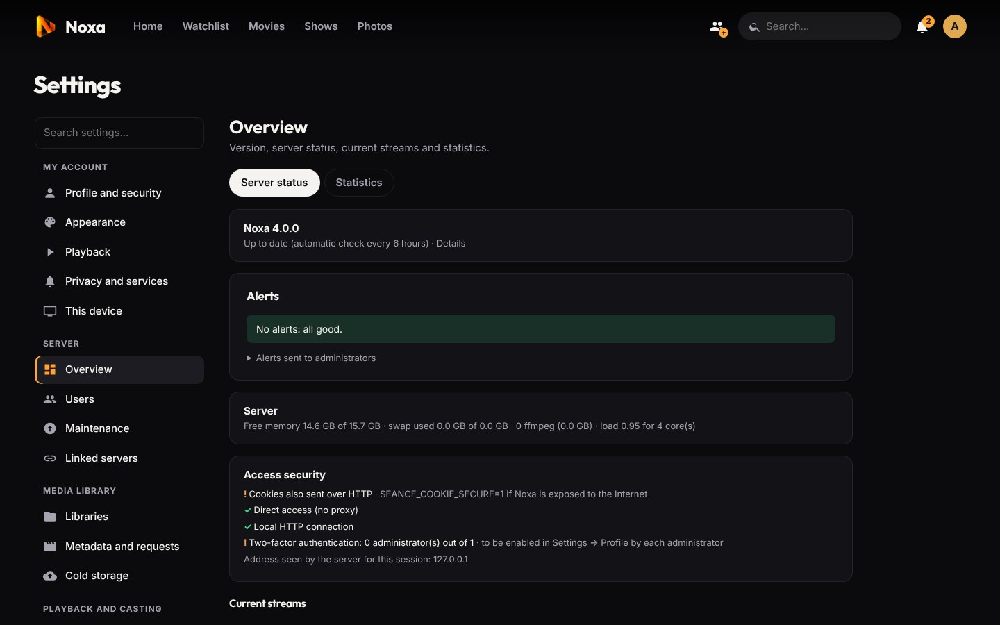

# Linked servers

[← Back to the README](../README.md) · Previous: [Apps](apps.md)

Two (or more) Noxa servers that belong to you, say your home and a holiday house, or your place and your parents', can be **linked**. They then behave like one service: the same accounts everywhere, each server's libraries visible and playable from the others, and administration of every server from any of them.

> Keep this for your own servers. Sharing commercial movies with another household goes beyond private copying in most countries.

**Contents:** [Pairing](#pairing-two-servers) · [What is shared](#what-is-shared) · [Libraries](#libraries) · [Playback](#playback) · [Accounts](#accounts) · [Administration](#administration-from-one-server) · [Network](#network) · [Unlinking and outages](#unlinking-and-outages)

## Pairing two servers

*Settings → Linked servers*:

1. On the server the other one can reach, **Invite a server**. Check the proposed address (IP or name, followed by port **8421**), then copy the `NEXIS1-…` invitation.
2. On the other server, **Join a server** and paste the invitation. It is valid for 15 minutes and works once.

Before joining, Noxa lists the usernames that exist on both servers and asks, for each one, whether they are **different people** (the joining server's account is renamed, e.g. `lea-home2`, and both accounts then exist everywhere) or **the same person** (the accounts merge, keeping the password, 2FA and profile of the inviting server; each server keeps its own history and lists for that account).

## What is shared

| | Shared? |
|---|---|
| Accounts, passwords, 2FA, profiles, PINs, parental controls, languages, avatars, library access | Yes, synchronized within a minute; the most recent change wins |
| Personal preferences (appearance, languages, subtitles, playback, home rows, wallpaper) | Yes, translated for the other server; *This device* settings stay on the device |
| Resume points and watched state | Yes, sent back to the server that owns the title |
| Libraries | Yes, as new libraries or merged into yours (see below) |
| TMDB key and Seerr | Lent to servers that have none |
| Watch together groups | Yes, joinable from any server |
| Backups | Copied to the other servers (can be turned off) |
| Sessions | No: sign in once on each server |
| Photos, audiobooks, DLNA | No: each server keeps its own |

## Libraries

Each library received from the other server is set up in *Linked servers*:

- **New library** (default): it appears as one more library, under its own name, with a small server badge on its page.
- **Merge with "…"**: its titles join one of your libraries of the same type. A movie or show present on both servers appears **once** (same TMDB, IMDb or TVDB id, otherwise same title and year), and the seasons and episodes of both are gathered under one show.

Posters and metadata come from the server that owns the files, which also scans its own folders.

## Playback

A title from the other server plays from yours: the owning server reads the file, converts it if needed and sends it through the link. Subtitles, previews, chapters and "Skip intro" work as for a local title. **Offline downloads** work too: the server that has the file prepares the MP4.

**Title on both servers:** the copy is chosen automatically, without asking:

1. the one with the wanted audio language or subtitles, if only one has it;
2. then a server that is not **busy** (3 or more streams by default, *Linked servers → This server*; 0 to ignore);
3. then the best quality (resolution, then bitrate);
4. on a tie, the least busy server, then this server.

Seeking or changing tracks keeps the same copy. If the chosen server stops answering, the other copy takes over. This spreads the CPU and disk load; the stream still flows through the server your device is connected to.

**Remote speed:** quality depends on the **upload** bandwidth of the server that has the file; pick a lower quality if it stutters.

## Accounts

- An account created on either server appears on the other within a minute. A deletion is final.
- A username created on both servers before they sync is never merged silently: one of them is renamed (`nina-2`) on both servers and it is reported in *Linked servers*.
- Pairing again later recognizes the accounts the two servers already share.
- Linked servers can only **read** titles on behalf of an account, never administer.

## Administration from one server

At the top of every administration page, the **Managed server** selector picks which server you are configuring: this one or a linked one. All pages (libraries, users, tasks, transcoding, backups, update, alerts…) then apply to that server, relayed over the encrypted link and on behalf of your account (you must be an administrator on both). Each action is logged on the server it changes. A server can refuse this (*Linked servers → Administration from linked servers*), a setting that can only be changed locally.

## Network

- **Encryption:** each server has its own certificate (EC P-256 key, created at the first pairing in the data folder). The invitation contains its fingerprint, so the joining server checks that it talks to the right server; the two then exchange a secret presented with every request. Everything runs over TLS on port 8421, with no VPN, domain name or certificate authority, even if the interface itself stays on plain HTTP at home.
- **Ports:** only **one** of the two servers needs to be reachable by the other. On a home network there is nothing to do. Over the Internet, forward port 8421 to one of them (router port forwarding, or a reverse proxy in **TCP / stream** mode: a regular HTTPS proxy would break the pinned certificate). The other server opens an encrypted tunnel to it by itself: nothing to open on its side. If neither can be reached, use a VPN such as Tailscale or WireGuard.
- **Restrictions:** the port only accepts paired servers and does not serve the web interface.
- **Configuration:** change the port with `SEANCE_FED_PORT` in `/etc/seance/seance.env`. With Docker, also publish `8421:8421`. `openssl` is needed once to create the certificate (installed by the script, the package and the Docker image).
- **IP changes:** prefer a name (dynamic DNS) in the invitation. If the reachable server's IP changes, dropped connections are detected within about a minute and reopened as soon as the name points to the new address; set a new address with the **Address** button if you used an IP. The server that is not reachable can change IP freely: it reopens its tunnel by itself.

## Unlinking and outages

- **Server switched off or unreachable:** the other keeps working normally with its own libraries. After about thirty seconds, titles only the missing server has are hidden, and so are its non-merged libraries; they come back by themselves when it answers again.
- **Unlink a server:** accounts stay on both servers but are no longer synchronized; its libraries and titles disappear from this server (including those merged into yours), your own titles and progress do not move, and no file is touched. The other server is told if it answers; if it was off, a new pairing with a new invitation replaces the old link.

---

Next: [Cold storage →](cold-storage.md)
