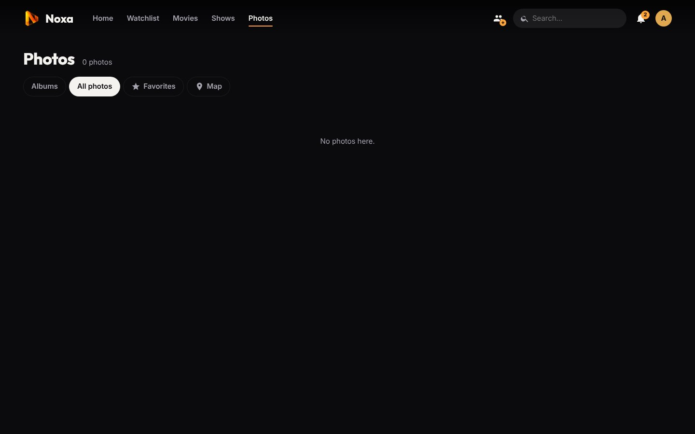

# Photos, audiobooks, live TV and DLNA

[← Back to the README](../README.md) · Previous: [Cold storage](cold-storage.md)

**Contents:** [Photo library](#photo-library) · [Audiobooks](#audiobooks) · [Live TV](#live-tv-iptv) · [DLNA server](#dlna-server)

## Photo library

*Settings → Libraries → **+ Add***, type **Photos**, then the photo folder.

- **Albums:** every sub-folder is an album, and its sub-folders are sub-albums. Photos placed directly in the library folder show without an album.
- **All photos:** newest to oldest, grouped by month. Dates and orientation come from the EXIF data (JPEG, TIFF), otherwise from the file date; portrait photos are shown the right way up.
- **Viewer:** full screen, arrows or swipe to move, Space for the slideshow, Esc to close. The info button shows the date, size and camera; the original file downloads in one click.
- **Formats:** JPEG, PNG, WebP, GIF (animated as is), HEIC / HEIF (depending on the server's ffmpeg), TIFF and BMP. **Phone videos** (MP4, MOV, 3GP, WebM, MKV…) in the albums appear at their recording date and play in the viewer, as they are.
- **Favorites:** the star of the viewer adds a photo to the *Favorites* tab, personal to each account.
- **Map:** the *Map* tab places photos and videos by their GPS position (recorded by most phones), grouping nearby ones into a bubble with their count. The map background comes from OpenStreetMap: the browser downloads the tiles of the visible area from OpenStreetMap, but the photos' positions never leave your server.
- **Share an album:** in an album, **Share album** creates a link valid for 1 day to 3 months, giving access to that album and its sub-albums without an account, and nothing else. The shared page hides GPS positions (the downloadable original keeps its EXIF). Links are copied and revoked from the same window.
- Nothing is ever written into the photo folders. Access is set per account like other libraries. Photo libraries are not shared with linked servers and not shown in the Android TV app (use DLNA on a TV).

## Audiobooks

*Settings → Libraries → **+ Add***, type **Audiobooks**, then the books folder.

- **Layout:** one folder per book (`Author/Title/01.mp3, 02.mp3…`, or `Title/`), played in order; or a single `.m4b` with its chapters. Formats: MP3, M4B, M4A, AAC, FLAC, OGG, Opus.
- **Details:** title, author, narrator, year and summary come from the file tags (album, artist, composer…), otherwise from the folder names. Cover: `cover.jpg` or `folder.jpg` next to the files, otherwise the embedded picture. Chapters: those of the file, or one per file.
- **Listening:** in the audio player at the bottom of the screen, which stays while you browse: play / pause, −30 / +30 s, progress bar, **speed** (×0.8 to ×2, kept from one book to the next), **sleep timer** (15 to 60 min, or end of chapter), **chapters**. On phones, the lock screen and headset controls work (previous / next = chapter). The position is saved every 15 seconds and on pause; *In progress* gathers the books you started. *Start over* and *Mark as finished* are on the book page.
- Audiobooks are not shared with linked servers or over DLNA, and are not shown in the Android TV app.

## Live TV (IPTV)

*Settings → Live TV*: add one or more **sources**, each made of an **M3U / M3U8** playlist (the address given by your IPTV provider or ISP box, or the path of a `.m3u` file on the server) and, if needed, an **XMLTV guide** (`.xml` or `.xml.gz`; optional when the playlist names it in its `url-tvg` header). The `tvg-id`, `tvg-name`, `tvg-logo`, `tvg-chno`, `group-title` and `#EXTVLCOPT:http-user-agent` attributes are supported.

- Channels are available to **every user** in the **Live TV** tab: a grid with what is on now and next, a **programme guide**, search, groups and personal **favourites**. In the player: ↑ / ↓ to change channel, `L` for the list.
- **Groups…** hides whole groups for everyone. An option hides live TV for age-restricted profiles.
- Browsers cannot play MPEG-TS, so Noxa receives the stream with ffmpeg and turns it into HLS. **H.264 video is copied** as is and the audio converted to stereo AAC; MPEG-2 or HEVC video is converted to H.264 (never / automatic / always). A channel watched by several people is **received only once**; ffmpeg stops 45 s after the last viewer leaves.
- **Simultaneous channels (max.):** most providers limit the number of connections; beyond it, a message says so.
- Channels that fail twice in a row are hidden, and shown again as soon as they answer.
- The *Refresh channels and TV guide* task runs every 12 hours. Only add playlists from providers you trust.

## DLNA server

Noxa can also appear as a **DLNA / UPnP media server** on your local network. TVs (Samsung, LG, Sony…), consoles, boxes and apps like VLC then find it in their sources and play its content without a Noxa app.

- **Enable it** in *Settings → Casting and offline → DLNA*: turn it on, choose the displayed name and the shared libraries (all by default).
- **Content:** movies; shows with their seasons and episodes; photos by album. Each photo is also offered as a 1920 px JPEG turned the right way up, which every TV can display (HEIC included).
- **Files are played as they are:** no conversion, so a format the device cannot read will not play; use a Noxa app or the website instead.
- **No accounts:** every device on the local network sees the shared libraries, without parental controls, so only share what suits everyone. Addresses outside the local network are refused, and the service is off by default.
- **Ports:** discovery uses UDP 1900 (SSDP multicast), content goes through Noxa's web port (8420).
- **Docker:** the container must use the host network (`network_mode: host`), because discovery does not cross Docker's internal network. Nothing to do in LXC or with the `.deb`.
- Titles of a linked server are not shared over DLNA: each server shares its own.

---

Next: [Personalization and discovery →](personalization.md)
