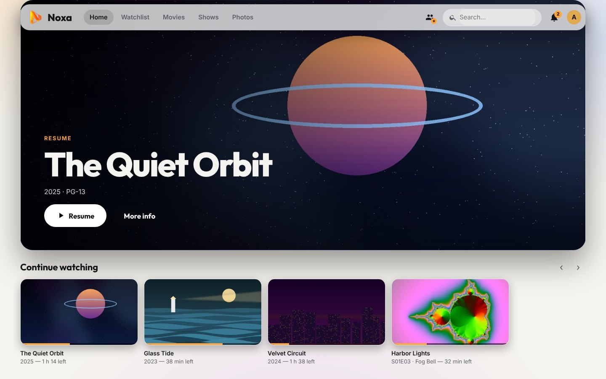
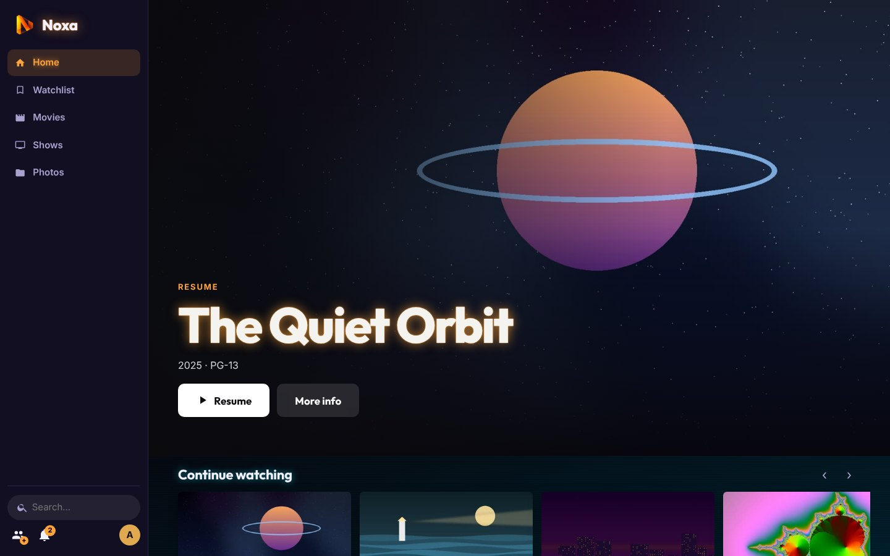
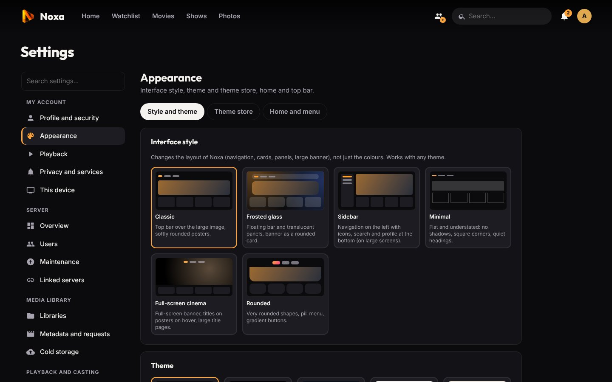
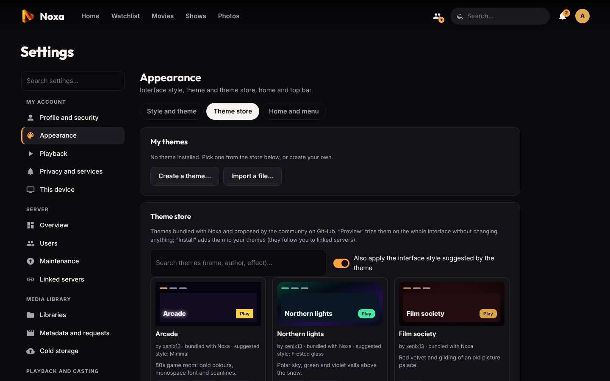
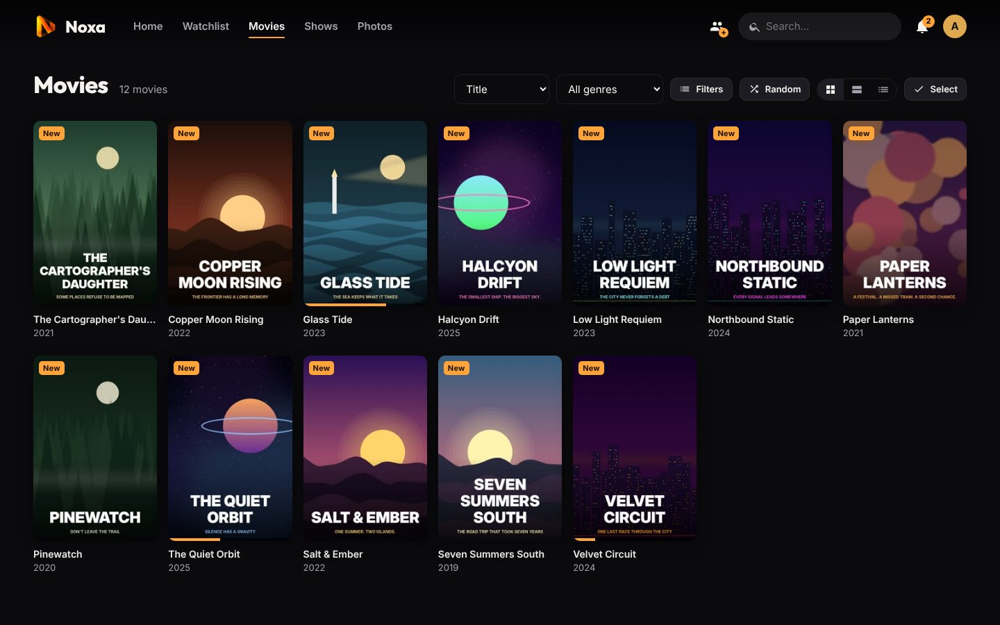

# Personalization and discovery

[← Back to the README](../README.md) · Previous: [Photos, audiobooks, live TV and DLNA](more-libraries.md)

Every person sets up their own Noxa in *Settings → My account*. These settings belong to the profile, follow it to [linked servers](linked-servers.md), and *Profile and security → Restore default settings* starts over.

**Contents:** [Layouts and themes](#interface-layouts-and-themes) · [Theme store](#theme-store) · [Home screen](#home-screen-and-menu) · [Playback preferences](#playback-preferences) · [Content and notifications](#content-and-notifications) · [Browsing](#browsing-the-libraries) · [Lists](#collections-watchlist-and-playlists) · [Discover and requests](#discover-and-requests) · [Trakt and Letterboxd](#trakt-and-letterboxd) · [Languages](#languages)

## Interface layouts and themes

*Settings → Appearance → Style and theme*.

**Interface style** changes the layout, not only the colours, and combines with every theme:

| Style | Look |
|---|---|
| **Classic** | Top bar over the large banner (default) |
| **Frosted glass** | Floating bar and translucent panels, banner as a rounded card |
| **Sidebar** | Navigation on the left with icons, search and profile at the bottom (on large screens) |
| **Minimal** | Flat, square corners, no shadows, quiet headings |
| **Full-screen cinema** | Full-screen banner, titles on hover, large title pages |
| **Rounded** | Very rounded shapes, pill menu, gradient buttons |

A device can keep its own style (*This device*), e.g. *Classic* on the TV and *Sidebar* on the computer.

**Also:** theme (dark, deep black for OLED, midnight blue, light, sepia, high contrast, or automatic with the device), **accent colour** (9 suggestions or any colour), text size, density, poster size, what cards show (title and year, progress, watched tick, 4K / HDR and "New" badges, TMDB rating), and a **wallpaper** shown faded behind the pages: a title's backdrop (**⋯ → Use as wallpaper**), a different title of yours every day, a gradient, a colour or an uploaded picture.

## Theme store

*Settings → Appearance → Theme store* offers complete themes: colours, gradient background, font, corner radius and effects (neon, scanlines, film grain, starry sky, vignette, poster glow), with a suggested interface style.

- **Bundled with Noxa:** Neon city, Retro 80s, Vaporwave, Arcade, Terminal, Hero, Dark city, Galaxy, Northern lights, Desert, Western, Steampunk, Forest, Deep ocean, Horror, Halloween, Christmas, Film society, Film noir, Kawaii, Pastel and Frost.
- **From the community:** anyone can add a theme to this repository (folder [`static/themes`](../static/themes/README.md)). CI checks every proposal, a maintainer reviews and merges it, and every server then offers it (servers re-read the index every 6 hours; devices never contact GitHub).
- **Preview** tries a theme on the whole interface without changing anything; **Install** adds it to *My themes* (20 at most). Installed themes follow the account and keep working if the store is unreachable.
- **Create a theme:** an editor with a live preview on the whole interface, then *Save and use*, *Export* (`.json` file, to import elsewhere or share) or *Propose on GitHub* (GitHub opens with the file filled in; you only need to confirm the pull request).
- **Safe by design:** a theme is only a description checked by the server, never code or images (no free CSS, no URLs): a theme from elsewhere cannot imitate a sign-in screen or send anything out of the server. Text contrast is checked so that it stays readable.
- Admins can turn the online store off or point it at their own theme repository.

## Home screen and menu

*Settings → Appearance → Home and menu*:

- **Opening page:** home, Watchlist, Discover, Live TV or a library.
- Order and visibility of the home rows and the menu links, including "For a short evening" (unwatched movies under 1 h 30) and "Shows to pick back up" (started, then left aside for 2 months).
- **Pinned rows:** a collection, a playlist, a genre or a combination of library filters can be pinned to the home screen with the **Pin to Home** button of its page (20 rows at most).
- **My rows:** your own rows (name, library, genre, watched or not, years, sorting, number of titles).
- **Large banner:** the title you are watching (otherwise a recent addition, by default), a recent addition, a random title, a title from your Watchlist, or none.

## Playback preferences

*Settings → Playback*: quality, audio and subtitle languages (with **per-library languages**), autoplay of episodes, **subtitle appearance** (size, font, colour, background, outline, position, with a preview), **anti-spoiler** (blurred thumbnails and hidden summaries for unwatched episodes), skip durations, starting speed, volume memory and the night sound mode.

*Settings → This device* holds what belongs to one browser or TV: its own quality and subtitle size, reduced motion, **visual effects** (full, or light without blur, transparency or shadows for a TV or a modest device; chosen automatically on devices with little memory), forced or disabled remote navigation, the device name and the player keys. These settings stay on the device and override the profile's.

## Content and notifications

*Settings → Privacy and services*:

- **Hidden genres:** movies and shows of a genre (horror, say) disappear for you from libraries, home, search and suggestions; their page stays reachable from a direct link.
- **Private mode** (off by default): progress is still saved so you can resume, but nothing goes into the history or to Trakt, and administrators see "Private playback" instead of the title.
- **Notifications:** new episodes of the shows you follow (on by default), **muted shows** (**⋯ → Stop notifying me of new episodes**), **quiet hours**. Admin alerts and the arrival of a requested title always get through.

## Browsing the libraries

- **Filters:** watched state (unwatched, in progress, watched), decade, length, resolution (4K, 1080p…), HDR, audio language, subtitles and rating. A combination of filters can be pinned to the home screen. Views: posters, wide thumbnails or a detailed list (remembered per library). **Random** starts an unwatched movie (or opens a show) of the chosen genre.
- **Multiple selection:** **Select**, then click titles to tick them (*All* for everything shown): mark watched / unwatched, download, add to a playlist, hide for yourself, archive to cold storage; admins can also refresh metadata or add to a collection.
- **Search:** titles, episodes, people (cast, directors), genres and years ("1994"); without an exact match, the closest titles are offered (typos). Cast names are clickable and list their movies and shows on your server.
- **Your rating:** 1 to 5 stars on a movie or show, personal. It also steers suggestions (4 or 5 = I like, 1 or 2 = I don't) and is a sort option. **Like** / **Dislike** and **⋯ → Don't suggest again** refine recommendations further.
- **⋯ → Hide for me:** the title disappears from your libraries, home, search and suggestions; others still see it. The list of hidden titles is in *Home and menu*.
- **History:** the *History* page shows, by year or month, your watch time, number of movies and episodes, active days, longest streak, favourite day, genres and most watched titles.

## Collections, watchlist and playlists

- **Collections:** when a movie belongs to a saga according to TMDB, the collection is created automatically (poster, backdrop and summary included). It appears in the library's **Collections** tab and on the movies' pages. Admins can create, rename or delete their own collections (**⋯ → Collections…**).
- **Watchlist:** the bookmark button adds a movie or show to your personal list (the *Watchlist* tab and a home row). A movie marked as watched leaves it.
- **Playlists:** **⋯ → Add to a playlist…** on a movie, episode, season or show; *Play all* plays them in order. **Share with the household** makes a playlist visible to every account on the server, who can add to it and reorder it; only its creator can rename it, stop sharing or delete it, and everyone only sees the titles they can access.

## Discover and requests

The **Discover** tab shows the catalogues of the streaming platforms available in your region, the week's trends and a search (TMDB key needed). Each title says whether it is **already on the server**, **requested** or **downloading**.

**Request** sends the request to [Seerr](https://docs.seerr.dev), which passes it on to Radarr / Sonarr; for a show you choose the seasons. A missing title added to your **Watchlist** is requested automatically (can be turned off) and lands in your list when it arrives.

**Setting up Seerr:**

1. Install Seerr ([documentation](https://docs.seerr.dev)) and connect it to Radarr and Sonarr.
2. In Seerr, *Settings → General*: copy the **API key**.
3. In Noxa, *Settings → Metadata and requests → Requests (Seerr)*: enter Seerr's address (e.g. `http://192.168.1.20:5055`) and the key, then *Save and test*.

When a Seerr account matches a Noxa account (username, display name or the start of the e-mail address), the request is made **in that person's name** and Seerr's rules apply (approval, quotas). Otherwise it is made in the name of the API key's owner. A server without Seerr can use the Seerr of a [linked server](linked-servers.md).

## Trakt and Letterboxd

*Settings → Privacy and services → Trakt and Letterboxd*, for each person:

- **Trakt:** an administrator registers an app once on trakt.tv (*Settings → Your API Apps → New Application*, Redirect URI `urn:ietf:wg:oauth:2.0:oob`) and pastes its Client ID and Client Secret on this page. Each person then links their account with a code typed on trakt.tv: Noxa never sees the Trakt password. Every 6 hours and on demand, movies and episodes watched on one side become watched on the other (with their date), ratings are added (1 to 5 stars here, 1 to 10 on Trakt) and so is the watchlist. Nothing is ever removed.
- **Letterboxd** (no public API, so files): **Export for Letterboxd** produces a CSV of your watched movies with dates and ratings, to import on letterboxd.com. **Import the Letterboxd export…** reads the ZIP downloaded from Letterboxd (watched films, diary, ratings, watchlist) and matches films by title and year; those not on the server are listed.

## Languages

The interface is available in **English** and **French**. Each person chooses their language in *Profile and security*; it follows them on all devices, Android TV included. The administrator chooses the language of new accounts and of the sign-in page in *Settings → Users*. The language of TMDB summaries and titles is a server setting (*Metadata*). Adding a language is described in [Development](development.md#translations).

---

Next: [Administration →](administration.md)
