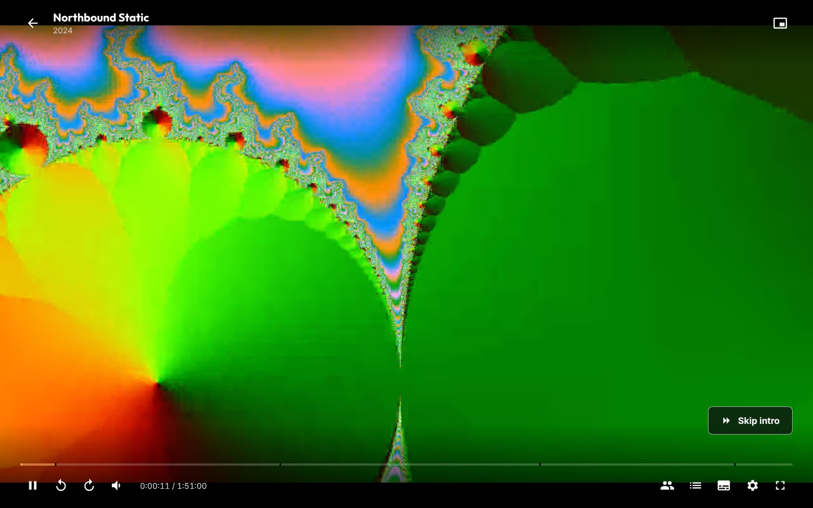
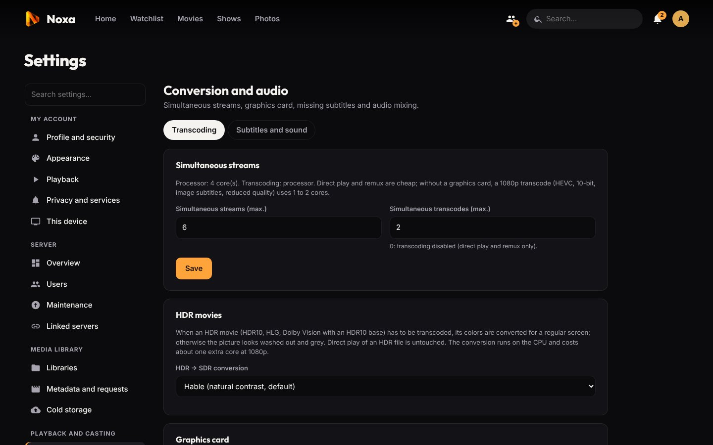

# Playback, transcoding and subtitles

[← Back to the README](../README.md) · Previous: [Getting started](getting-started.md)

**Contents:** [How a video is played](#how-a-video-is-played) · [Automatic quality](#automatic-quality) · [Conversions and the graphics card](#conversions-and-the-graphics-card) · [HDR](#hdr-movies) · [Audio](#audio) · [Subtitles](#subtitles) · [Chapters, intros and credits](#chapters-intros-and-credits) · [The player](#the-player) · [Casting](#casting-to-a-tv) · [Remote control](#remote-control) · [Watch together](#watch-together)

## How a video is played

When a video starts, the player tells the server exactly which codecs the device can decode (H.264, HEVC 8/10-bit, AV1, VP9, AAC, AC3, E-AC3, FLAC, Opus…). Noxa then picks the cheapest way to play it:

| Mode | When | CPU cost |
|---|---|---|
| **Direct play** | The file (often an MP4) can be read as is by the device | none |
| **Remux** | The video is fine but the container (MKV) or the audio track (DTS, TrueHD, 5.1…) is not | very low: only the audio is converted |
| **Transcode** | The device cannot decode the video (HEVC in Firefox, 10-bit H.264…), image subtitles must be burned in, or a lower quality was asked for | 1 to 2 cores per 1080p stream without a graphics card |

The player receives a playlist covering the whole video, cut into 6-second segments (aligned on keyframes when remuxing). Segments are produced on demand in fMP4 with the original timestamps: the position is always exact and seeking never restarts the stream. If the player jumps far ahead, ffmpeg restarts at that point.

ffmpeg pauses once it is 3 minutes ahead and runs at a lower priority. The number of simultaneous conversions is limited in *Settings → Conversion and audio → Transcoding*. The ⚙ menu of the player shows the mode in use and why.

## Automatic quality

With the default quality (**Automatic**, *Settings → Playback → Default quality*), the device measures its speed to the server when a video starts (2.5 seconds at most; the measure is kept for 10 minutes). The server then picks:

1. the **original** if the connection is at least 30 % faster than the file's bitrate (direct play or remux, nothing converted);
2. otherwise the best converted quality that fits: 1080p (8 Mbit/s), 720p (4 Mbit/s), then 480p (1.5 Mbit/s) at the lowest, never above the file's resolution;
3. if playback stalls twice within three minutes, it steps down one notch by itself.

On a home network the original almost always fits. A fixed quality (Original, 1080p…) can be chosen per account, per device and in the player.

**Buffering:** playback starts with 5 s of video ready in direct play, 12 s in remux and 20 s when converting (3 to 10 s after a seek). If the network or the CPU slows down, the player pauses long enough to rebuild a 15 to 25 s buffer; if it keeps happening while converting, it offers 720p.

## Conversions and the graphics card

A graphics card lets one server convert many more streams at once. Setup (NVIDIA NVENC, Intel / AMD VAAPI, Proxmox LXC passthrough) is described in [Installation → Hardware transcoding](installation.md#hardware-transcoding-graphics-card). The *Overview* page shows which streams use the card.

## HDR movies

When an HDR movie (HDR10, HDR10+, HLG, Dolby Vision with an HDR10 base layer) has to be converted, its colours are tone-mapped to SDR (BT.709) for a regular screen; otherwise the picture looks washed out and grey. Direct play and remux of an HDR file are not touched. The method is set in *Settings → Conversion and audio → Transcoding*: Hable (default), Mobius, Reinhard or off. Tone mapping runs on the CPU (ffmpeg's `zscale` filter, included in the Docker image) and costs about one extra core in 1080p, even with a graphics card.

## Audio

- **Language:** choose the audio and subtitle tracks on the title page before playing, or in the player. The choice is **remembered for the whole show** (or the movie), per person. Default languages are set in *Settings → Playback*, and can differ per library (anime in Japanese with subtitles, movies dubbed…).
- **Surround to stereo:** 5.1 / 7.1 tracks (AC3, E-AC3, DTS, TrueHD, AAC 5.1…) are downmixed for stereo devices with the method chosen in *Settings → Conversion and audio → Subtitles and sound* (ffmpeg, Dave750, Dialogue (night), RFC 7845 or AC-4), followed by an adjustable gain. A limiter prevents clipping. Each person can also turn on a **night mode** (dialogue boosted, effects softened).
- **Passthrough:** the Android TV app sends Dolby Digital, Dolby Digital+, DTS and TrueHD as is to your amplifier or soundbar when the HDMI output accepts it.

## Subtitles

Text subtitles (SRT, ASS/SSA, WebVTT, mov_text), embedded or external, are displayed by the device **without converting the video**. ASS subtitles keep their positioning, karaoke and attached fonts (rendered by libass compiled to WebAssembly, via [JASSUB](https://github.com/ThaUnknown/jassub)); PGS (Blu-ray) subtitles are drawn by the browser; only VobSub (DVD) needs burning in.

**Forced subtitles** ("Forced", "Signs & Songs"…) only translate signs and songs: Noxa offers them only when the audio is in their language, and then selects them automatically.

**Appearance:** size, font, colour, background, outline and position, with a preview, in *Settings → Playback* (not applied to styled ASS or PGS).

### Embedded subtitles are extracted once

Subtitles inside an MKV can only be read by going through the whole file, minutes for a 30 GB movie on a NAS. Noxa **extracts them once** (every track and attached font in a single pass) and keeps them in its cache. The cache follows the **file** (size and date), not its title: a renamed or moved file finds its subtitles again. Extraction happens:

- **at scan time**, in the background for each new file (throttled during playback); *Settings → Conversion and audio → Subtitles and sound → Prepare everything now* processes the whole library;
- **when a title page opens**, with priority;
- for the next episode, while the current one plays.

If subtitles are not ready when you press play, playback starts as soon as they cover the first 4 minutes; extraction is much faster than real time and stays ahead.

### Missing subtitles: OpenSubtitles

Noxa downloads missing subtitles itself, no Bazarr needed. *Settings → Conversion and audio → Subtitles and sound → OpenSubtitles*: a free account on [opensubtitles.com](https://www.opensubtitles.com) (20 subtitles a day, more with VIP) and an API key created on the site (*API consumers*).

- **Automatic:** every night and after each import, a movie or episode without a complete subtitle in one of your languages gets one, newest first. The task stops at the daily quota and resumes the next day; a title with no result is retried after a week.
- **Best match first:** subtitles synced to the exact file (by its hash) come first, then the most downloaded. Machine translations and forced-only files are skipped; hearing-impaired (SDH) ones are only used if there is nothing else (configurable).
- **By hand:** on a title page, **⋯ → Find subtitles…** lists the results; one click adds one. Admins can remove a downloaded subtitle (it is then not downloaded again).
- Files go to Noxa's data folder (`data/subtitles/`), never next to your videos, and are included in backups.

### Subtitles generated from the audio: Whisper

For a video with no subtitle in its spoken language, even after OpenSubtitles, Whisper can write them from the voice. They are **in the spoken language** and marked "generated" in the player. *Settings → Conversion and audio → Subtitles and sound → Whisper*, either:

- **A transcription service** (recommended, especially with Docker): anything compatible with the OpenAI API (`/v1/audio/transcriptions`), for example [Speaches](https://speaches-ai.github.io/speaches/) (faster-whisper) in a container next to Noxa, ideally with a GPU, and the `Systran/faster-whisper-small` model. OpenAI itself works too (`whisper-1`, API key), but the audio then leaves your network. Noxa sends the audio in 10-minute chunks (mono MP3).
- **On the server**: ffmpeg 8 built with whisper.cpp (the `whisper` filter) or the `whisper-cli` program. Noxa downloads the chosen model (tiny, base, small, medium) to `data/whisper`.

It is slow (minutes to over an hour per movie on a CPU), runs one video at a time and pauses during playback. By hand: **⋯ → Generate subtitles (Whisper)** (admins). Automatically: the *Generate missing subtitles (Whisper)* task, off by default, at most 3 titles per run.

## Chapters, intros and credits

- **Previews:** hovering or dragging the progress bar shows a thumbnail of the scene and the chapter name.
- **Chapters:** marks on the bar and a thumbnail picker in the player (Chapters button or `C`) and on the title page.
- **Skip intro / next episode:** openings and end credits are found from named chapters (`Opening`, `OP`, `Intro`, `Ending`, `ED`, `Credits`…). For files without named chapters, the *Detect intros and credits* task compares the **audio fingerprints** (Chromaprint) of the episodes of a season: the passage they share is the opening. It runs after each import and every night. Priority: manual marks, named chapters, audio fingerprint, then song-length chapters. Admins can fix the marks from the player's ⚙ menu.
- **Skip recap:** a "Previously", "Recap"… chapter in the first third of an episode shows a separate **Skip recap** button, which can also be automatic (*Settings → Playback*).
- **Next episode** starts after a countdown; autoplay can be limited or turned off.

## The player

- Audio, subtitles and quality during playback; speed (0.75× to 2×, keys `<` and `>`); sleep timer (end of episode, 15 to 90 min); shuffle for shows.
- Skip back / forward durations (5 to 30 s and 10 to 90 s) and the starting speed are personal settings; the volume is remembered.
- **Mini player:** the button at the top right (or `I`) shrinks the player into a corner while you keep browsing.
- **Keyboard:** `?` shows every shortcut anywhere in Noxa; `/` jumps to search. Player keys can be remapped in *Settings → This device*.
- **Remote control and gamepad:** the whole interface works without a mouse (arrows, OK, Back; Xbox / PlayStation controllers: A to select, B to go back, Start to play / pause).

## Casting to a TV

In the player, **AirPlay** (Safari on Mac, iPhone, iPad) sends the video to an Apple TV, and **Chromecast** (Chrome or Edge) to a Chromecast or Google TV. The buttons only appear when a device is found.

- The TV plays the video itself; the server prepares a stream it can read (Chromecast: H.264 and AAC, converted if needed; Apple TV: H.264 or HEVC, Dolby audio passed through).
- Progress follows playback on the TV; stopping the cast resumes on your device.
- The TV fetches the stream through a secret, temporary address, and must reach the server at the same address as your browser.
- The Chromecast button loads Google's Cast SDK (www.gstatic.com) when the player opens, in Chrome and Edge only. Subtitles are not sent to the TV yet.

A **DLNA server** is also available for TVs and consoles without an app: see [DLNA](more-libraries.md#dlna-server).

## Remote control

Profile menu → **Remote control**: from your phone, control the video playing on another device of your account (computer, TV, tablet): play / pause, position, ±10 / 30 s, next episode, volume, audio, subtitles, speed, stop. A device appears as soon as it plays something, under the name set in *Settings → This device*.

## Watch together

Several people watch the same video at the same time, each on their own device, at home or remotely.

- On a movie or episode, **Watch together** creates a group (name, and whether only the host controls playback). In the player, the same button lists the members and their status and copies the **invite link**. Running groups appear on the home screen and in the top bar.
- **Plan ahead:** the ＋ button of the top bar opens a **lobby** where members gather; starting a title in that group starts it for everyone.
- Play, pause, seeking, chapters, "Skip intro" and **next episode** are synchronized; someone joining late arrives at the right moment.
- Everyone keeps their own stream (quality, language, subtitles). Small drifts are corrected by slightly adjusting the speed, big ones by a seek. If someone's connection struggles, the group waits for them (12 s at most).
- Resume points and history stay personal, and access rights (libraries, age rating) are checked for every member.
- **Across [linked servers](linked-servers.md):** a group lives on the server where it was created and shows up on the others; each person joins from their own server and watches the copy that server picks.

---

Next: [Apps and offline viewing →](apps.md)
